---
## Author
author:
  name: Чжу Ино
  affiliation:
    - name: Российский университет дружбы народов
      country: Российская Федерация
      postal-code: 117198
      city: Москва
      address: ул. Миклухо-Маклая, д. 6
## Title
title: Лабораторная работа № 1
subtitle:  Установка ОС Linux
date: today
date-format: "YYYY-MM-DD"
format:
  beamer:
    theme: "Madrid"
    colortheme: "default"
    fonttheme: "professionalfonts"
    mainfont: "DejaVu Serif"
    sansfont: "DejaVu Sans"
    monofont: "DejaVu Sans Mono"
    lang: ru
    toc: false
    slide-level: 2
    logo: logo_rudn.png
    header-includes:
      - \usepackage{graphicx}
      - \setbeamertemplate{logo}{\includegraphics[width=0.5cm]{logo_rudn.png}}
---

# Информация

## Докладчик

::: {.columns align=center}
::: {.column width="50%"}
- Чжу Ино
- группа НПИбд-03-25
- Российский университет дружбы народов им. П. Лумумбы
- Студенческий билет: 1132258331
:::
::: {.column width="50%"}
:::
:::

# Вводная часть

## Актуальность

- Установка операционной системы — базовый навык системного администратора
- Виртуальные машины позволяют безопасно экспериментировать с ОС
- Навыки работы с Linux необходимы для дальнейшей работы с серверами

## Объект и предмет исследования

- Объект: операционная система Linux (Fedora)
- Предмет: процесс установки и начальной настройки ОС на виртуальную машину

## Цели и задачи

- Цель:
  - Получить практические навыки установки ОС Linux на виртуальную машину
- Задачи:
  - Установить Fedora Linux на VirtualBox
  - Выполнить начальную настройку системы
  - Настроить раскладку клавиатуры
  - Установить имя пользователя и хоста
  - Установить ПО для создания документации
  - Проанализировать загрузку с помощью dmesg

## Материалы и методы

- Операционная система Linux, оболочка `bash`
- Виртуальная машина: VirtualBox
- Команды анализа загрузки: `dmesg`, `grep`
- Средства документирования: `pandoc`, `texlive`

# Теоретические сведения

## Виртуальные машины

- Виртуальная машина — программная эмуляция компьютера
- Позволяет запускать несколько ОС на одном физическом компьютере
- Популярные средства: VirtualBox, QEMU, VMware
- Основные параметры: RAM, HDD, сеть, UEFI

## Команда dmesg

- `dmesg` — вывод сообщений ядра Linux
- Позволяет проанализировать последовательность загрузки системы
- С фильтром `grep` можно искать конкретную информацию
- Пример: `sudo dmesg | grep -i "Linux version"`

# Выполнение лабораторной работы

## Установка Fedora Linux

- Виртуальная машина VirtualBox
- Параметры: 2048 MB RAM, 80 GB HDD, NAT, UEFI

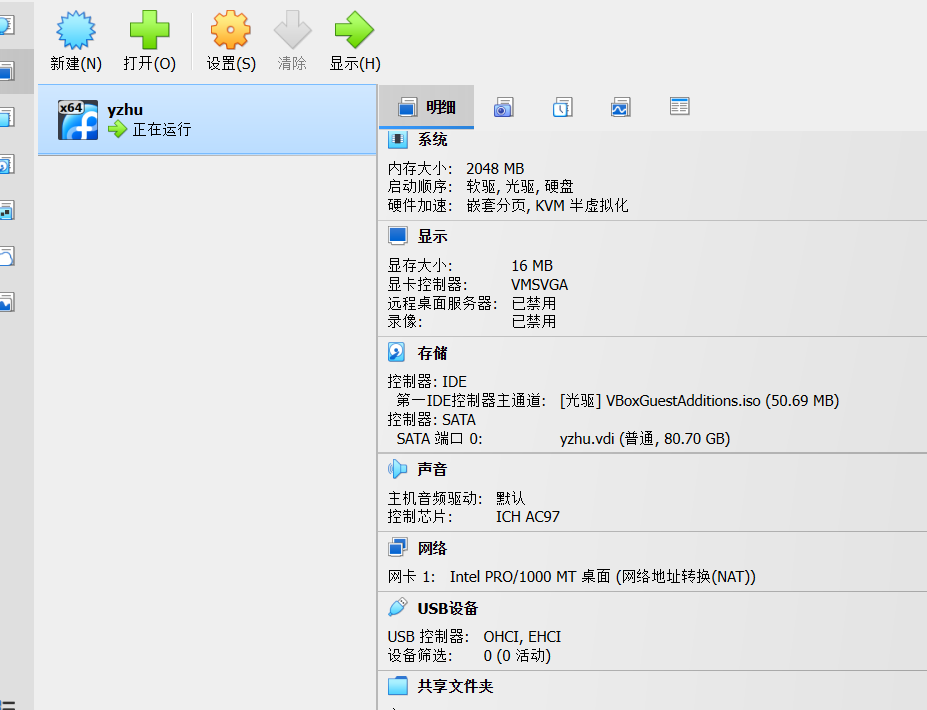{#fig-vm}

## Настройка имени пользователя и хоста

- Имя пользователя: учётная запись студента
- Имя хоста: учётная запись студента

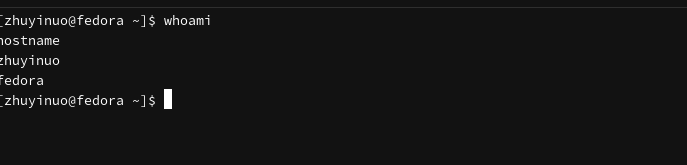{#fig-hostname}

## Настройка раскладки клавиатуры

- Файл `/etc/X11/xorg.conf.d/00-keyboard.conf`

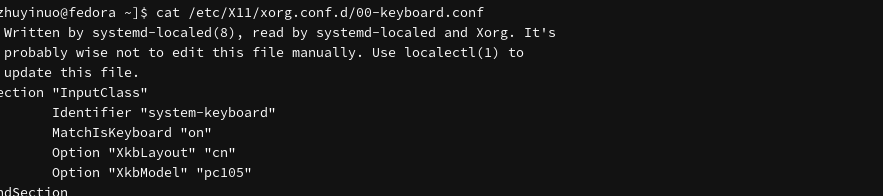{#fig-keyboard}

## Установка ПО для документации

- pandoc, texlive-scheme-full

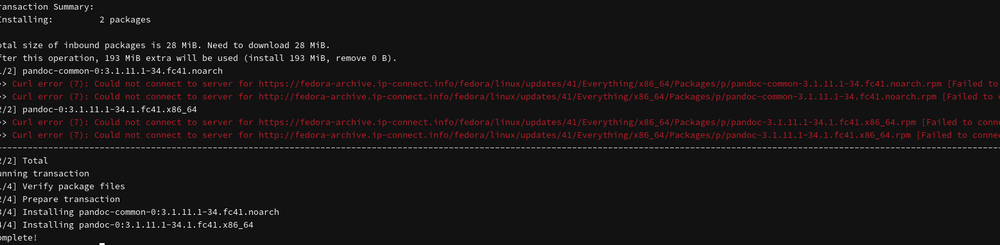{#fig-pandoc}

## Анализ загрузки системы: версия ядра

- `sudo dmesg | grep -i "Linux version"`

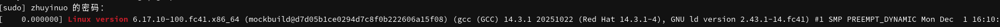{#fig-kernel}

## Анализ загрузки системы: частота процессора

- `sudo dmesg | grep -i "mhz"`

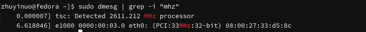{#fig-mhz}

## Анализ загрузки системы: модель процессора

- `sudo dmesg | grep -i "CPU0"`

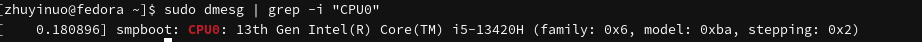{#fig-cpu}

## Анализ загрузки системы: память

- `sudo dmesg | grep -i "Memory"`

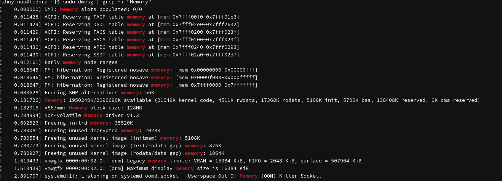{#fig-memory}

## Анализ загрузки системы: гипервизор

- `sudo dmesg | grep -i "Hypervisor"`

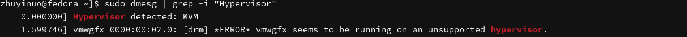{#fig-hypervisor}

## Анализ загрузки системы: файловая система

- `sudo dmesg | grep -i "filesystem"`

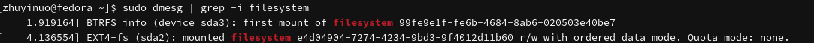{#fig-fs}

## Анализ загрузки системы: монтирование

- `sudo dmesg | grep -i "mount"`

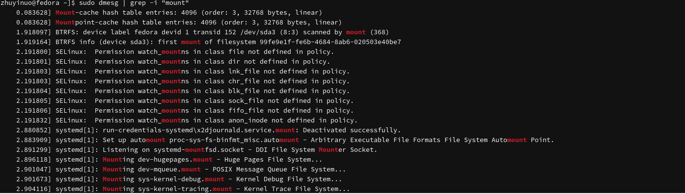{#fig-mount}

# Результаты

## Результаты работы

- Освоены команды анализа загрузки: `dmesg`, `grep`
- Получена информация о версии ядра, процессоре, памяти
- Определён гипервизор и файловые системы
- Приобретены навыки работы с VirtualBox и командной строкой

## Ответы на контрольные вопросы (1)

1. Учётная запись содержит: имя, пароль, UID, GID, комментарий, домашний каталог, оболочку
2. Команды справки: `man`, `--help`
3. Перемещение: `cd`
4. Просмотр каталога: `ls`
5. Объём каталога: `du -sh`

## Ответы на контрольные вопросы (2)

6. Создание/удаление: `mkdir`, `rmdir`, `touch`, `rm`
7. Права: `chmod`, `chown`, `chgrp`
8. История команд: `history`
9. Файловые системы: ext4, XFS, Btrfs, NTFS, FAT32
10. Просмотр ФС: `df -h`, `mount`, `cat /proc/mounts`

# Заключение

## Главный вывод

В ходе работы получены практические навыки установки ОС Linux на виртуальную машину: установка Fedora, начальная настройка, работа с dmesg, анализ загрузки системы.