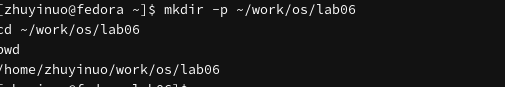
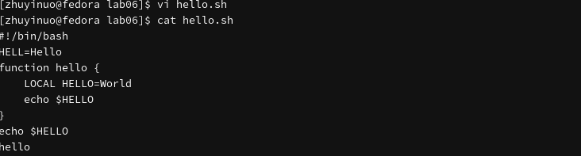
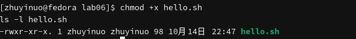
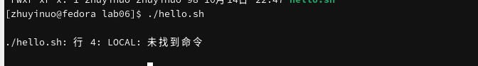
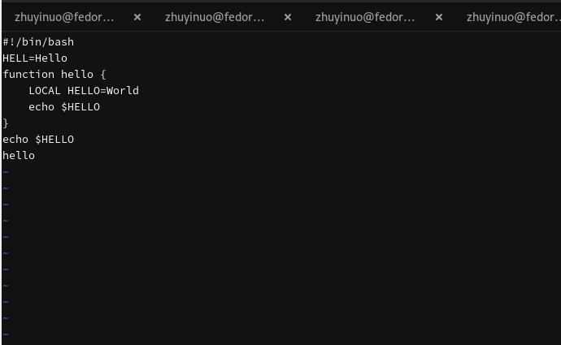
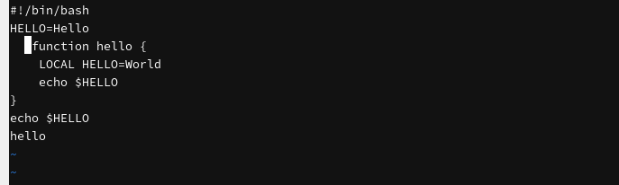
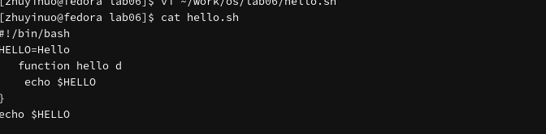
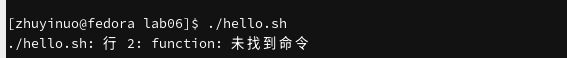

---
## Author
author:
  name: Чжу Ино
  affiliation:
    - name: Российский университет дружбы народов
      country: Российская Федерация
      postal-code: 117198
      city: Москва
      address: ул. Миклухо-Маклая, д. 6
## Title
title: Лабораторная работа № 10
subtitle:  Текстовой редактор vi
date: today
date-format: "YYYY-MM-DD"
format:
  beamer:
    theme: "Madrid"
    colortheme: "default"
    lang: ru
    toc: false
    slide-level: 2
    mainfont: "DejaVu Serif"
    sansfont: "DejaVu Sans"
    monofont: "DejaVu Sans Mono"
  html:
    embed-resources: true
---

# Информация

## Докладчик

::: {.columns align=center}
::: {.column width="50%"}
- Чжу Ино
- группа НПИбд-03-25
- Российский университет дружбы народов им. П. Лумумбы
- Студенческий билет: 1132258331
:::
::: {.column width="50%"}
:::
:::

# Вводная часть

## Цель работы

- Познакомиться с редактором vi
- Получить практические навыки работы с vi

## Задачи

- Изучить теоретический материал
- Ознакомиться с vi
- Выполнить упражнения

# Теоретические сведения

## Режимы vi

- Командный режим
- Режим вставки
- Режим последней строки

## Запуск

```bash
vi <имя_файла>
```

## Выход

- `:wq` — сохранить и выйти
- `:q!` — выйти без сохранения

## Команды

- `i`, `a`, `o` — вставка
- `dd`, `dw`, `d$` — удаление
- `u` — отмена
- `Y`, `p` — копирование и вставка
- `/текст` — поиск

# Выполнение лабораторной работы

## Создание каталога

```bash
mkdir -p ~/work/os/lab06
cd ~/work/os/lab06
```



## Создание файла

```bash
vi hello.sh
```


## Просмотр

```bash
cat hello.sh
```



## Права и запуск

```bash
chmod +x hello.sh
./hello.sh
```





## Редактирование

```bash
vi ~/work/os/lab06/hello.sh
```





## Финальный файл





# Результаты

## Результаты работы

- Изучен редактор vi
- Освоены три режима
- Выполнены упражнения по созданию и редактированию файла

# Заключение

## Главный вывод

Освоены основные возможности редактора vi: режимы работы, команды навигации, вставки, удаления, копирования, поиска.