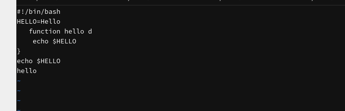
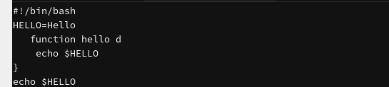
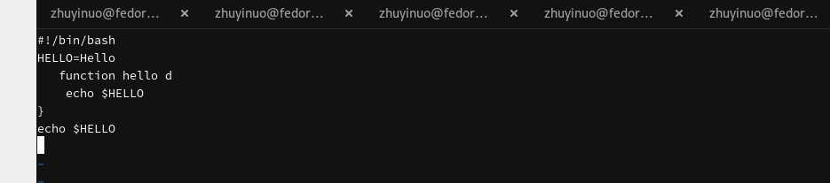
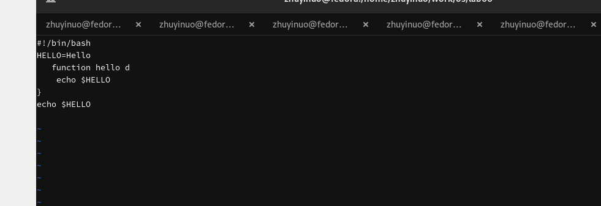
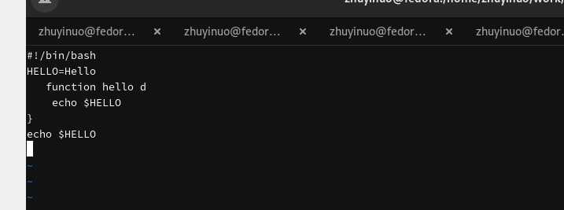

# Цель работы

Познакомиться с операционной системой Linux. Получить практические навыки работы с редактором vi, установленным по умолчанию практически во всех дистрибутивах.

# Задачи

1. Изучить теоретический материал.
2. Ознакомиться с редактором vi.
3. Выполнить упражнения, используя команды vi.

# Теоретические сведения

## Три режима работы vi

- **Командный режим** — ввод команд, навигация по файлу
- **Режим вставки** — ввод содержимого файла
- **Режим последней (командной) строки** — запись изменений, выход

## Запуск vi

```bash
vi <имя_файла>
```

## Выход из vi

- `Esc` → `:wq` — сохранить и выйти
- `Esc` → `:q!` — выйти без сохранения

## Основные группы команд

### Управление курсором

- `h` / `←` — влево
- `l` / `→` — вправо
- `k` / `↑` — вверх
- `j` / `↓` — вниз

### Позиционирование

- `0` — начало строки
- `$` — конец строки
- `G` — конец файла
- `nG` — строка n

### Перемещение по файлу

- `Ctrl+d` — пол-экрана вперёд
- `Ctrl+u` — пол-экрана назад
- `Ctrl+f` — страница вперёд
- `Ctrl+b` — страница назад

### Вставка текста

- `a` — после курсора
- `A` — в конец строки
- `i` — перед курсором
- `I` — в начало строки
- `o` — новая строка под курсором
- `O` — новая строка над курсором

### Удаление текста

- `x` — один символ
- `dw` — слово
- `d$` — до конца строки
- `d0` — до начала строки
- `dd` — строка
- `ndd` — n строк

### Отмена и повтор

- `u` — отменить
- `.` — повторить

### Копирование и вставка

- `Y` — строка в буфер
- `nY` — n строк
- `yw` — слово
- `p` — вставить после курсора
- `P` — вставить перед курсором

### Замена

- `cw` — слово
- `c$` — до конца строки
- `r` — символ
- `R` — текст

### Поиск

- `/текст` — поиск вперёд
- `?текст` — поиск назад

### Команды последней строки

- `:w` — записать
- `:wq` — записать и выйти
- `:q!` — выйти без записи
- `:set nu` — номера строк
- `:set ic` — игнорировать регистр

# Выполнение лабораторной работы

## Создание каталога

```bash
mkdir -p ~/work/os/lab06
cd ~/work/os/lab06
pwd
```

{#fig-mkdir width=80%}

## Создание файла hello.sh

```bash
vi hello.sh
```

{#fig-vi-create width=80%}

## Просмотр файла

```bash
cat hello.sh
```

{#fig-cat width=80%}

## Права на выполнение

```bash
chmod +x hello.sh
ls -l hello.sh
```

{#fig-chmod width=80%}

## Выполнение

```bash
./hello.sh
```

{#fig-run width=80%}

## Открытие в vi

```bash
vi ~/work/os/lab06/hello.sh
```

{#fig-vi-open width=80%}

## Редактирование HELL → HELLO

{#fig-edit width=80%}

## Удаление LOCAL

{#fig-delete-local width=80%}

## Замена на local

{#fig-local width=80%}

## Вставка echo $HELLO

{#fig-echo width=80%}

## Удаление последней строки

{#fig-dd-last width=80%}

## Отмена

{#fig-undo width=80%}

## Сохранение

{#fig-wq width=80%}

## Финальный файл

```bash
cat hello.sh
```

{#fig-cat-final width=80%}

## Финальный запуск

```bash
./hello.sh
```

{#fig-run-final width=80%}

# Выводы

В ходе работы изучен редактор vi, его три режима работы, основные группы команд: управление курсором, вставка, удаление, копирование, замена, поиск, команды последней строки. Выполнены упражнения по созданию и редактированию файла.

# Контрольные вопросы

**1. Режимы работы vi.**

Командный, режим вставки, режим последней строки.

**2. Как выйти без сохранения?**

`Esc` → `:q!`

**3. Команды позиционирования.**

`0`, `$`, `G`, `nG`.

**4. Что такое слово в vi?**

Последовательность символов, разделённая пробелами, табуляцией, возвратом каретки.

**5. Как перейти в начало/конец файла?**

`gg` — начало, `G` — конец.

**6. Основные группы команд.**

Управление курсором, вставка, удаление, копирование, вставка из буфера, замена, поиск.

**7. Заполнить строку символами $.**

`i` → ввод `$` → `Esc`.

**8. Отменить действие.**

`u`.

**9. Команды последней строки.**

`:w`, `:wq`, `:q!`, `:set`, `:e!`.

**10. Позиция конца строки.**

`$`.

**11. Опции vi.**

`:set all`, `:set nu`, `:set list`, `:set ic`.

**12. Как определить режим?**

По виду экрана: командный — без приглашения, вставки — текст вводится, последней строки — внизу `:`.

**13. Граф режимов.**

Командный ↔ Режим вставки (через `i`, `a`, `o`), Командный ↔ Режим последней строки (через `:`).

# Список литературы

1. Курячий К. В. Операционная система UNIX. — М. : ИНТУИТ, 2016.
2. Робачевский А., Немнюгин С., Стесик О. Операционная система UNIX. — БХВ-Петербург, 2010.
3. Колисниченко Д. Н. Самоучитель системного администратора Linux. — БХВ-Петербург, 2011.