---
## Author
author:
  name: Чжу Ино
  affiliation:
    - name: Российский университет дружбы народов
      country: Российская Федерация
      postal-code: 117198
      city: Москва
      address: ул. Миклухо-Маклая, д. 6
## Title
title: Лабораторная работа № 11
subtitle:  Текстовой редактор emacs
date: today
date-format: "YYYY-MM-DD"
format:
  beamer:
    theme: "Madrid"
    colortheme: "default"
    lang: ru
    toc: false
    slide-level: 2
    mainfont: "DejaVu Serif"
    sansfont: "DejaVu Sans"
    monofont: "DejaVu Sans Mono"
  html:
    embed-resources: true
---

# Информация

## Докладчик

::: {.columns align=center}
::: {.column width="50%"}
- Чжу Ино
- группа НПИбд-03-25
- Российский университет дружбы народов им. П. Лумумбы
- Студенческий билет: 1132258331
:::
::: {.column width="50%"}
:::
:::

# Вводная часть

## Цель работы

- Познакомиться с редактором Emacs
- Получить практические навыки работы с Emacs

## Задачи

- Ознакомиться с теоретическим материалом
- Ознакомиться с Emacs
- Выполнить упражнения

# Теоретические сведения

## Основные термины

- Буфер — объект с текстом
- Фрейм — окно
- Окно — область фрейма
- Минибуфер — для ввода

## Запуск

```bash
emacs
```

## Выход

`Ctrl+X` `Ctrl+C`

## Префиксные клавиши

- `C-` — Ctrl
- `M-` — Meta (Alt)
- `S-` — Shift

## Команды

- `C-f`, `C-b`, `C-p`, `C-n` — навигация
- `C-a`, `C-e` — начало/конец строки
- `C-k`, `C-y` — вырезать/вставить
- `C-s`, `M-%` — поиск/замена
- `C-x C-f`, `C-x C-s` — файлы
- `C-x C-b`, `C-x b` — буферы

# Выполнение лабораторной работы

## Установка

```bash
sudo dnf -y install emacs
emacs --version
```

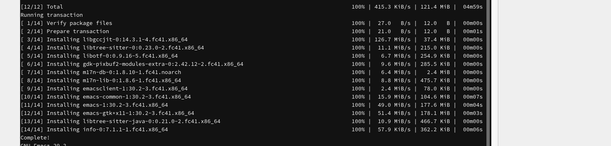

## Запуск и выход

```bash
emacs
```

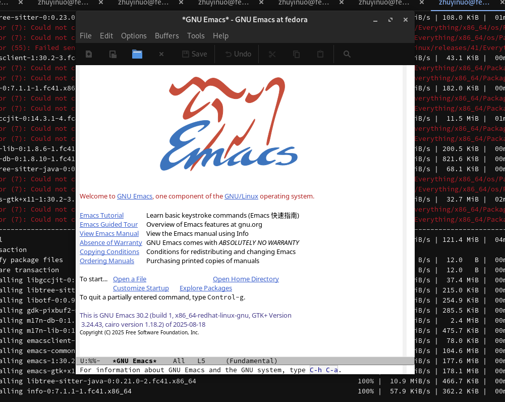

## Открытие файла

`C-x C-f` → `lab07.sh`

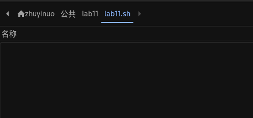

## Ввод текста

```
#!/bin/bash
HELL=Hello
function hello {
    LOCAL HELLO=World
    echo $HELLO
}
echo $HELLO
hello
```

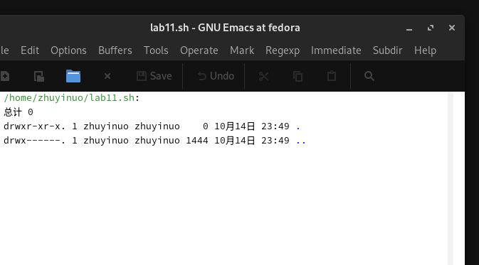

## Сохранение

`C-x C-s`

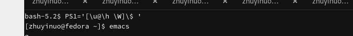

## Работа с текстом

`C-k` — вырезать, `C-y` — вставить

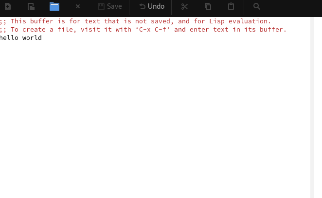

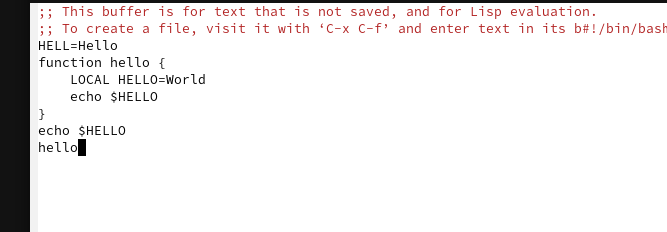

## Выделение и копирование

`C-space` — выделить, `M-w` — копировать

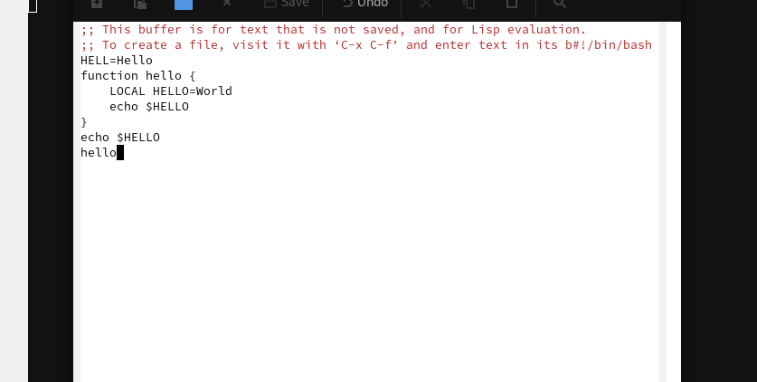

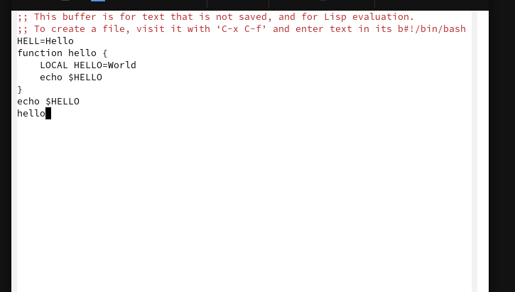

## Навигация

`C-a`, `C-e`, `M-<`, `M->`

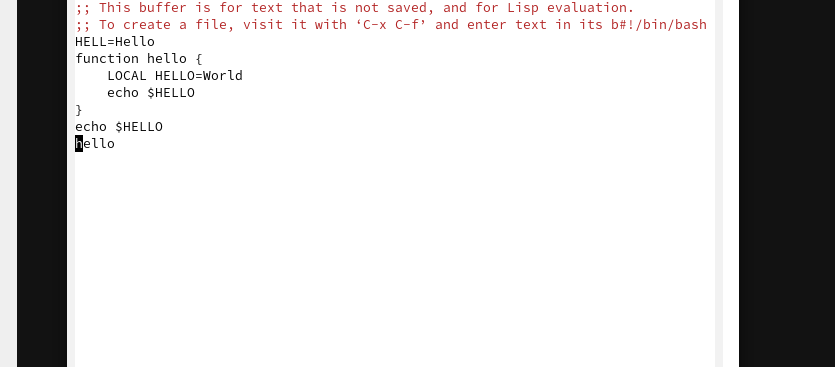

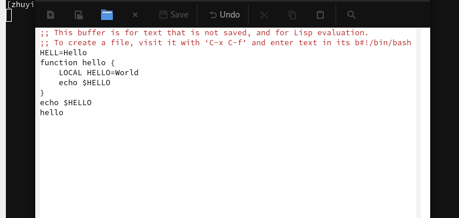

## Поиск и замена

`C-s`, `M-%`

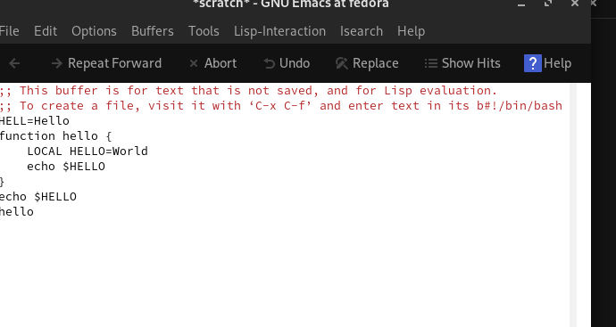

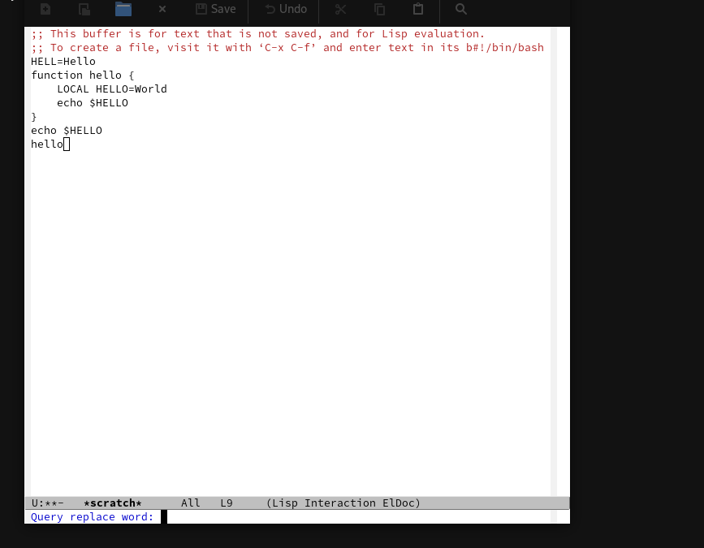

# Результаты

## Результаты работы

- Изучен редактор Emacs
- Освоены основные комбинации клавиш
- Выполнены упражнения по редактированию текста

# Заключение

## Главный вывод

Освоены основные возможности редактора Emacs: работа с буферами, окнами, текстом, поиск и замена.