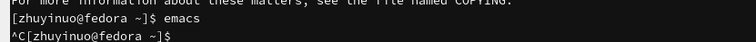
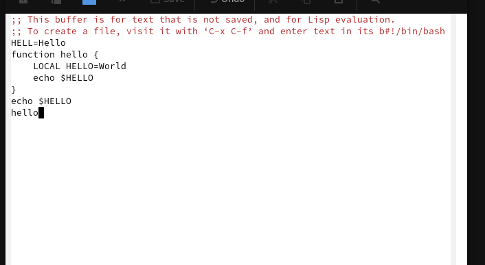

# Цель работы

Познакомиться с операционной системой Linux. Получить практические навыки работы с редактором Emacs.

# Задачи

1. Ознакомиться с теоретическим материалом.
2. Ознакомиться с редактором Emacs.
3. Выполнить упражнения.
4. Ответить на контрольные вопросы.

# Теоретические сведения

## Основные термины Emacs

- **Буфер** — объект, представляющий текст.
- **Фрейм** — окно в обычном понимании.
- **Окно** — прямоугольная область фрейма.
- **Область вывода** — строки внизу фрейма.
- **Минибуфер** — для ввода дополнительной информации.
- **Точка вставки** — место вставки/удаления.

## Запуск Emacs

```bash
emacs
```

или в фоне:

```bash
emacs &
```

## Выход из Emacs

- Меню `File` → `Quit`
- Или `Ctrl+X` `Ctrl+C`

## Префиксные клавиши

- `C-` — `Ctrl`
- `M-` — `Meta` (обычно `Alt` или `Esc`)
- `S-` — `Shift`

## Основные комбинации клавиш

### Перемещение курсора

- `C-p` — вверх на строку
- `C-n` — вниз на строку
- `C-f` — вперёд на символ
- `C-b` — назад на символ
- `C-a` — начало строки
- `C-e` — конец строки
- `C-v` — вниз на страницу
- `M-v` — вверх на страницу
- `M-f` — вперёд на слово
- `M-b` — назад на слово
- `M-<` — начало буфера
- `M->` — конец буфера

### Работа с текстом

- `C-d` — удалить символ перед курсором
- `M-d` — удалить слово
- `C-k` — удалить до конца строки
- `M-k` — удалить до конца предложения
- `C-q` — вставить символ
- `M-q` — выровнять абзац

### Выделение

- `C-space` — начать выделение
- `C-w` — удалить выделенное
- `M-w` — скопировать выделенное
- `C-y` — вставить из списка удалений

### Поиск и замена

- `C-s` — поиск вперёд
- `C-r` — поиск назад
- `M-%` — поиск и замена

### Файлы и буферы

- `C-x C-f` — открыть файл
- `C-x C-s` — сохранить
- `C-x C-b` — список буферов
- `C-x b` — переключить буфер
- `C-x 0` — закрыть окно
- `C-x 1` — закрыть все кроме текущего
- `C-x 2` — разделить по горизонтали
- `C-x o` — перейти в другое окно

# Выполнение лабораторной работы

## Установка Emacs

```bash
sudo dnf -y install emacs
emacs --version
```

{#fig-install width=80%}

## Запуск Emacs

```bash
emacs
```

{#fig-start width=80%}

## Выход из Emacs

`Ctrl+X` `Ctrl+C`

{#fig-exit width=80%}

## Открытие файла

`Ctrl+X` `Ctrl+F`, ввести `lab07.sh`

{#fig-open width=80%}

## Ввод текста

```
#!/bin/bash
HELL=Hello
function hello {
    LOCAL HELLO=World
    echo $HELLO
}
echo $HELLO
hello
```

{#fig-input width=80%}

## Сохранение

`Ctrl+X` `Ctrl+S`

{#fig-save width=80%}

## Вырезание строки

`Ctrl+K`

{#fig-cut width=80%}

## Вставка в конец

`Ctrl+Y`

{#fig-paste width=80%}

## Выделение области

`Ctrl+Space`

{#fig-select width=80%}

## Копирование области

`M-w`

{#fig-copy width=80%}

## Вставка области

`Ctrl+Y`

{#fig-paste-region width=80%}

## Перемещение в начало/конец строки

`Ctrl+A`, `Ctrl+E`

{#fig-line width=80%}

## Перемещение в начало/конец файла

`M-<`, `M->`

{#fig-file width=80%}

## Поиск

`Ctrl+S`

{#fig-search width=80%}

## Поиск и замена

`M-%`

{#fig-replace width=80%}

# Выводы

В ходе работы изучен редактор Emacs, его основные термины (буфер, фрейм, окно), комбинации клавиш для перемещения курсора, работы с текстом, выделения, поиска, замены, работы с файлами и буферами.

# Контрольные вопросы

**1. Кратко охарактеризуйте редактор Emacs.**

Emacs — мощный экранный редактор текста, написанный на языке Elisp.

**2. Особенности Emacs, сложные для новичка.**

Нестандартные комбинации клавиш, большое количество команд, режимы.

**3. Буфер и окно.**

Буфер — объект с текстом. Окно — прямоугольная область фрейма, отображающая один из буферов.

**4. Можно ли открыть больше 10 буферов?**

Да, ограничений нет.

**5. Буферы по умолчанию.**

`*scratch*`, `*Messages*`.

**6. Комбинации для ввода `C-c` и `C-c C-l`.**

`C-c` — префикс ввода основных команд. `C-c C-l` — вызов функции, зависящей от режима.

**7. Как поделить окно на две части?**

`C-x 2` — по горизонтали, `C-x 3` — по вертикали.

**8. Где хранятся настройки Emacs?**

`~/.emacs` или `~/.emacs.d/init.el`.

**9. Функция клавиши Enter.**

Вставка новой строки. Можно переназначить.

**10. Какой редактор удобнее?**

Emacs удобнее для сложной работы, vi — для быстрого редактирования. Каждый под свою задачу.

# Список литературы

1. Курячий К. В. Операционная система UNIX. — М. : ИНТУИТ, 2016.
2. Робачевский А., Немнюгин С., Стесик О. Операционная система UNIX. — БХВ-Петербург, 2010.
3. Колисниченко Д. Н. Самоучитель системного администратора Linux. — БХВ-Петербург, 2011.