# Цель работы

Изучить основы программирования в оболочке ОС UNIX/Linux. Научиться писать небольшие командные файлы.

# Задачи

1. Написать скрипт, делающий резервную копию самого себя.
2. Написать командный файл, обрабатывающий аргументы командной строки.
3. Написать командный файл — аналог команды `ls`.
4. Написать командный файл для подсчёта файлов с заданным расширением.

# Теоретические сведения

## Командные процессоры

- `sh` — Bourne shell
- `csh` — C shell
- `ksh` — Korn shell
- `bash` — Bourne Again Shell

## Переменные

```bash
mark=/usr/andy/bin
mv afile ${mark}
```

## Арифметические вычисления

- `let` — арифметические выражения
- Операторы: `+`, `-`, `*`, `/`, `%`, `==`, `!=`, `<`, `>`, `<=`, `>=`
- `(( ))` — запись условий

## Чтение ввода

```bash
read mon day trash
```

## Метасимволы

- `*` — любая строка
- `?` — один символ
- `[c1-c2]` — диапазон

Экранирование: `\`, `'`, `"`.

## Командные файлы

```bash
bash командный_файл [аргументы]
```

## Условный оператор if

```bash
if список-команд
then список-команд
[elif список-команд
then список-команд]
[else список-команд]
fi
```

## Циклы while и until

```bash
while список-команд
do список-команд
done
```

```bash
until список-команд
do список-команд
done
```

## Прерывание циклов

- `break` — завершить цикл
- `continue` — завершить итерацию

# Выполнение лабораторной работы

## Скрипт 1: резервная копия

```bash
#!/bin/bash
tar -czf ~/backup_$(date +%Y%m%d).tar.gz "$0"
```

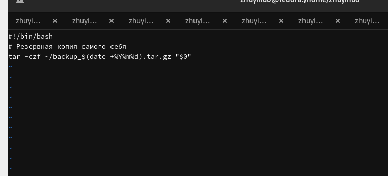{#fig-backup width=80%}

```bash
chmod +x backup.sh
./backup.sh
```

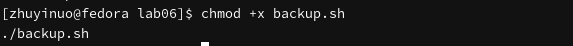{#fig-backup-run width=80%}

```bash
ls -lh ~/backup_*.tar.gz
```

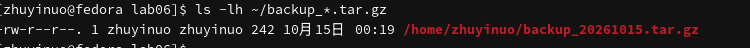{#fig-backup-check width=80%}

## Скрипт 2: аргументы

```bash
#!/bin/bash
for arg in "$@"; do
    if [ "$arg" -gt 10 ]; then
        echo "$arg"
    fi
done
```

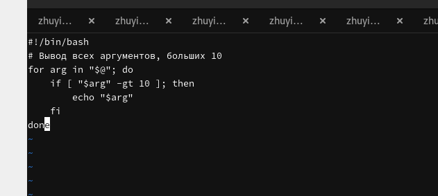{#fig-args width=80%}

```bash
chmod +x args.sh
./args.sh 5 12 8 20 3 15
```

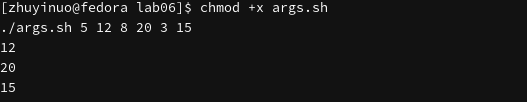{#fig-args-run width=80%}

```bash
./args.sh
```

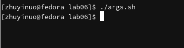{#fig-args-empty width=80%}

## Скрипт 3: аналог ls

```bash
#!/bin/bash
DIR="${1:-.}"
for file in "$DIR"/*; do
    if [ -d "$file" ]; then
        echo "d $file"
    elif [ -f "$file" ]; then
        echo "f $file"
    fi
done
```

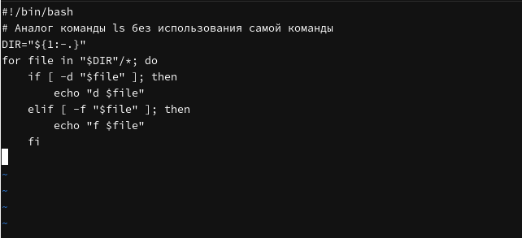{#fig-myls width=80%}

```bash
chmod +x myls.sh
./myls.sh
```

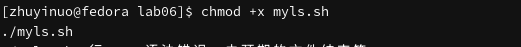{#fig-myls-run width=80%}

```bash
./myls.sh /etc
```

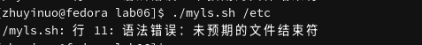{#fig-myls-dir width=80%}

```bash
ls
```

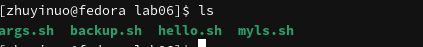{#fig-myls-compare width=80%}

## Скрипт 4: подсчёт файлов

```bash
#!/bin/bash
DIR="${1:-.}"
EXT="${2:-txt}"
count=0
for file in "$DIR"/*."$EXT"; do
    if [ -f "$file" ]; then
        count=$((count + 1))
    fi
done
echo "Файлов .$EXT в $DIR: $count"
```

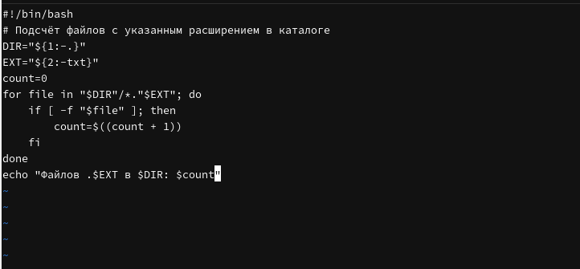{#fig-count width=80%}

```bash
chmod +x count.sh
./count.sh ~ txt
```

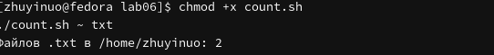{#fig-count-run width=80%}

```bash
./count.sh ~/work/os/lab06 sh
```

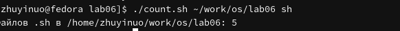{#fig-count-sh width=80%}

```bash
./count.sh /etc conf
```

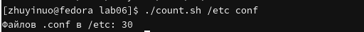{#fig-count-conf width=80%}

## Все скрипты

```bash
ls -la ~/work/os/lab06/
```

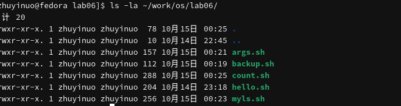{#fig-all width=80%}

```bash
./backup.sh && ./args.sh 5 12 20 && ./myls.sh && ./count.sh ~ txt
```

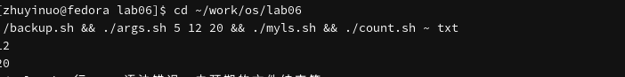{#fig-all-run width=80%}

# Выводы

В ходе работы изучены основы программирования в оболочке bash: переменные, арифметические вычисления, условные операторы, циклы, работа с аргументами. Написаны четыре командных файла: резервное копирование, обработка аргументов, аналог `ls`, подсчёт файлов.

# Контрольные вопросы

**1. Что такое командная оболочка?**

Программа для взаимодействия пользователя с ОС. Примеры: sh, csh, ksh, bash.

**2. Что такое POSIX?**

Набор стандартов для совместимости UNIX-подобных ОС.

**3. Как определяются переменные и массивы?**

```bash
var=value
set -A arr val1 val2
```

**4. Назначение операторов let и read.**

`let` — арифметика, `read` — чтение ввода.

**5. Арифметические операции.**

`+`, `-`, `*`, `/`, `%`, `==`, `!=`, `<`, `>`, `<=`, `>=`.

**6. Что означает `(( ))`?**

Арифметическое вычисление в bash.

**7. Стандартные переменные.**

`HOME`, `PATH`, `PS1`, `PS2`, `IFS`, `MAIL`, `TERM`, `LOGNAME`.

**8. Что такое метасимволы?**

`*`, `?`, `[...]`, `<`, `>`, `|`, `;`, `&`.

**9. Экранирование метасимволов.**

`\`, `'`, `"`.

**10. Как создавать и запускать командные файлы?**

Создать файл, `chmod +x`, запустить `./file.sh`.

**11. Как определяются функции?**

```bash
function name {
    commands
}
```

**12. Файл или каталог?**

```bash
test -f file
test -d dir
```

**13. set, typeset, unset.**

`set` — установка параметров, `typeset` — объявление переменных, `unset` — удаление.

**14. Передача параметров.**

`$1`, `$2`, ..., `$@`, `$#`.

**15. Специальные переменные bash.**

`$?`, `$$`, `$!`, `$0`, `$#`, `$@`, `$*`.

# Список литературы

1. Курячий К. В. Операционная система UNIX. — М. : ИНТУИТ, 2016.
2. Робачевский А., Немнюгин С., Стесик О. Операционная система UNIX. — БХВ-Петербург, 2010.
3. Колисниченко Д. Н. Самоучитель системного администратора Linux. — БХВ-Петербург, 2011.