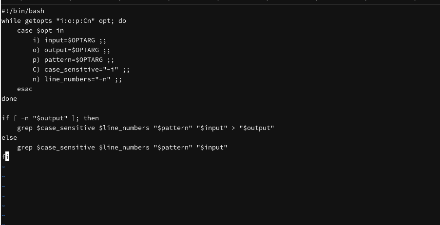
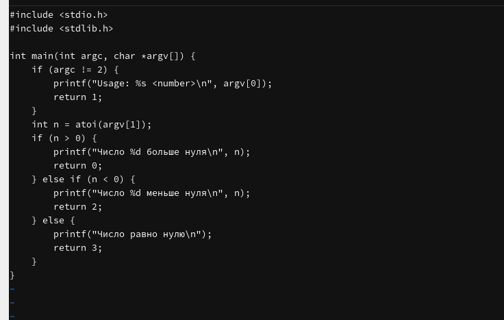
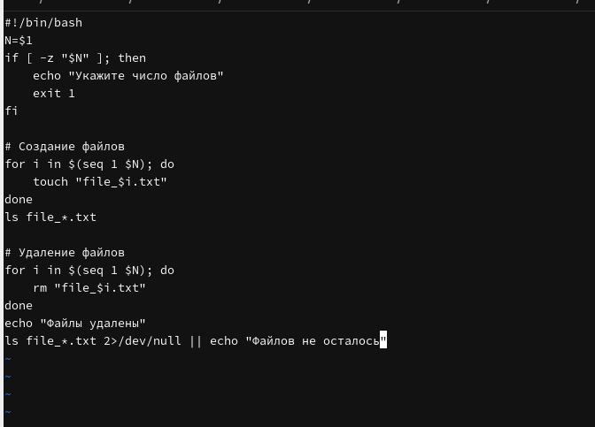
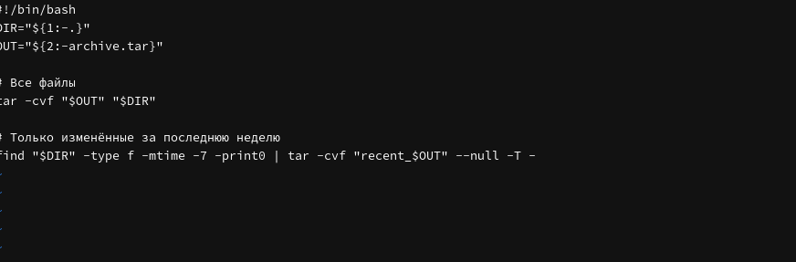
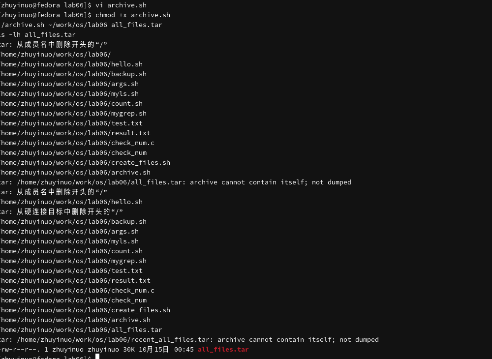

---
## Author
author:
  name: Чжу Ино
  affiliation:
    - name: Российский университет дружбы народов
      country: Российская Федерация
      postal-code: 117198
      city: Москва
      address: ул. Миклухо-Маклая, д. 6
## Title
title: Лабораторная работа № 13
subtitle:  Программирование в командном процессоре. Ветвления и циклы
date: today
date-format: "YYYY-MM-DD"
format:
  beamer:
    theme: "Madrid"
    colortheme: "default"
    lang: ru
    toc: false
    slide-level: 2
    mainfont: "DejaVu Serif"
    sansfont: "DejaVu Sans"
    monofont: "DejaVu Sans Mono"
  html:
    embed-resources: true
---

# Информация

## Докладчик

::: {.columns align=center}
::: {.column width="50%"}
- Чжу Ино
- группа НПИбд-03-25
- Российский университет дружбы народов им. П. Лумумбы
- Студенческий билет: 1132258331
:::
::: {.column width="50%"}
:::
:::

# Вводная часть

## Цель работы

- Изучить основы программирования в оболочке
- Научиться писать сложные командные файлы с ветвлениями и циклами

## Задачи

- `mygrep` с `getopts`
- C-программа определения знака числа
- Создание/удаление N файлов
- Архивирование файлов

# Теоретические сведения

## getopts

```bash
while getopts "i:o:p:Cn" opt; do
    case $opt in
        i) input=$OPTARG ;;
    esac
done
```

## Операторы

- `if`, `case`, `while`, `until`, `for`
- `break`, `continue`
- `true`, `false`

# Выполнение лабораторной работы

## mygrep

```bash
#!/bin/bash
while getopts "i:o:p:Cn" opt; do
    case $opt in
        i) input=$OPTARG ;;
        o) output=$OPTARG ;;
        p) pattern=$OPTARG ;;
        C) case_sensitive="-i" ;;
        n) line_numbers="-n" ;;
    esac
done
grep $case_sensitive $line_numbers "$pattern" "$input"
```




## C-программа

```c
if (n > 0) return 0;
else if (n < 0) return 2;
else return 3;
```




## Создание файлов

```bash
for i in $(seq 1 $N); do
    touch "file_$i.txt"
done
```



## Архивирование

```bash
tar -cvf "$OUT" "$DIR"
find "$DIR" -type f -mtime -7 | tar -cvf "recent_$OUT" -T -
```





# Результаты

## Результаты работы

- Написаны 4 командных файла
- Освоены ветвления и циклы
- Освоена работа с `getopts`

# Заключение

## Главный вывод

Изучены ветвления и циклы в bash, написаны скрипты для поиска, определения знака числа, создания файлов и архивирования.