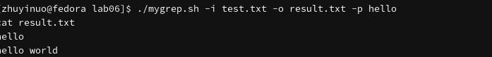
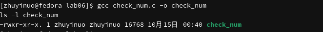
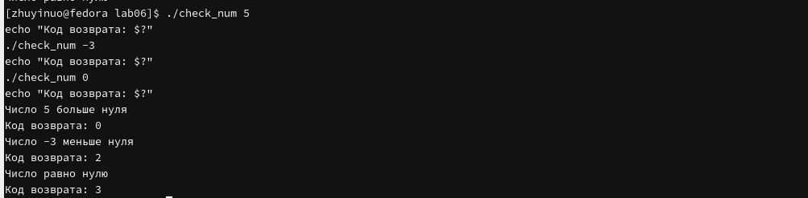
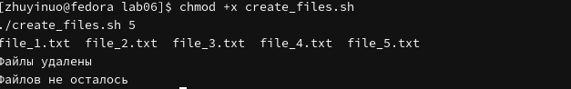
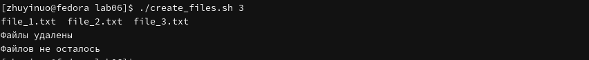
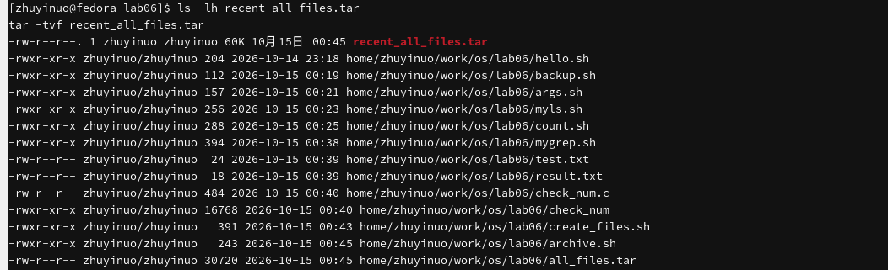
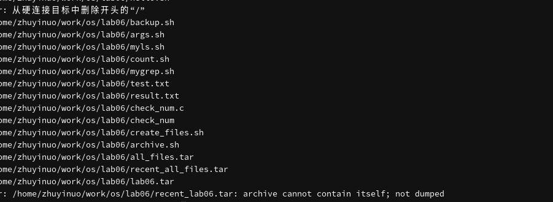
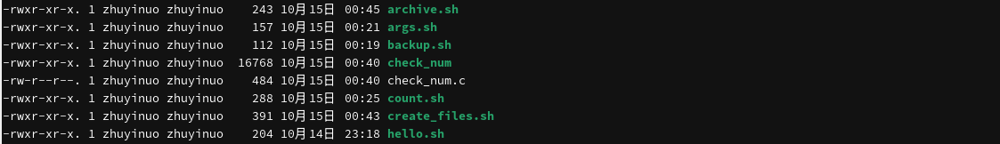
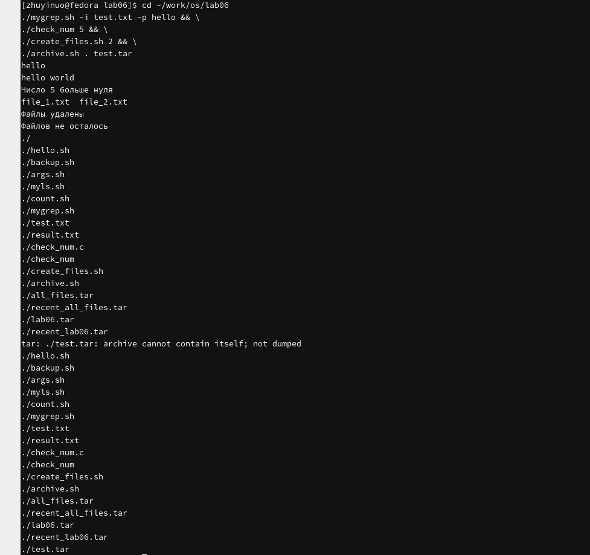

# Цель работы

Изучить основы программирования в оболочке ОС UNIX. Научиться писать более сложные командные файлы с использованием логических управляющих конструкций и циклов.

# Задачи

1. Написать командный файл с использованием `getopts` и `grep`.
2. Написать программу на C, определяющую знак числа.
3. Написать командный файл для создания и удаления N файлов.
4. Написать командный файл для архивирования файлов.

# Теоретические сведения

## Команда getopts

Позволяет разбирать опции командной строки:

```bash
while getopts "i:o:p:Cn" opt; do
    case $opt in
        i) input=$OPTARG ;;
        o) output=$OPTARG ;;
        p) pattern=$OPTARG ;;
        C) case_sensitive="-i" ;;
        n) line_numbers="-n" ;;
    esac
done
```

## Команда grep

```bash
grep [-опции] шаблон [файл...]
```

- `-i` — игнорировать регистр
- `-n` — номера строк

## Операторы управления

- `if ... then ... fi`
- `while ... do ... done`
- `until ... do ... done`
- `for ... in ... do ... done`
- `case ... esac`

## Прерывание цикла

- `break` — завершить цикл
- `continue` — завершить итерацию

## Команды true и false

- `true` — всегда возвращает 0
- `false` — всегда возвращает 1

## Условие if test -f

Проверяет, является ли файл обычным файлом.

## Отличие while от until

- `while` — выполняется, пока условие истинно
- `until` — выполняется, пока условие ложно

# Выполнение лабораторной работы

## Скрипт 1: mygrep

```bash
#!/bin/bash
while getopts "i:o:p:Cn" opt; do
    case $opt in
        i) input=$OPTARG ;;
        o) output=$OPTARG ;;
        p) pattern=$OPTARG ;;
        C) case_sensitive="-i" ;;
        n) line_numbers="-n" ;;
    esac
done

if [ -n "$output" ]; then
    grep $case_sensitive $line_numbers "$pattern" "$input" > "$output"
else
    grep $case_sensitive $line_numbers "$pattern" "$input"
fi
```

{#fig-mygrep width=80%}

```bash
chmod +x mygrep.sh
```

{#fig-mygrep-chmod width=80%}

```bash
echo -e "hello\nworld\nhello world" > test.txt
./mygrep.sh -i test.txt -p hello
```

{#fig-mygrep-run width=80%}

```bash
./mygrep.sh -i test.txt -o result.txt -p hello
cat result.txt
```

{#fig-mygrep-output width=80%}

## Скрипт 2: C-программа

```c
#include <stdio.h>
#include <stdlib.h>

int main(int argc, char *argv[]) {
    if (argc != 2) {
        printf("Usage: %s <number>\n", argv[0]);
        return 1;
    }
    int n = atoi(argv[1]);
    if (n > 0) {
        printf("Число %d больше нуля\n", n);
        return 0;
    } else if (n < 0) {
        printf("Число %d меньше нуля\n", n);
        return 2;
    } else {
        printf("Число равно нулю\n");
        return 3;
    }
}
```

{#fig-c width=80%}

```bash
gcc check_num.c -o check_num
ls -l check_num
```

{#fig-c-compile width=80%}

```bash
./check_num 5
./check_num -3
./check_num 0
```

{#fig-c-run width=80%}

```bash
./check_num 5
echo "Код возврата: $?"
./check_num -3
echo "Код возврата: $?"
./check_num 0
echo "Код возврата: $?"
```

{#fig-c-exit width=80%}

## Скрипт 3: создание файлов

```bash
#!/bin/bash
N=$1
if [ -z "$N" ]; then
    echo "Укажите число файлов"
    exit 1
fi

for i in $(seq 1 $N); do
    touch "file_$i.txt"
done
ls file_*.txt

for i in $(seq 1 $N); do
    rm "file_$i.txt"
done
echo "Файлы удалены"
ls file_*.txt 2>/dev/null || echo "Файлов не осталось"
```

{#fig-create width=80%}

```bash
chmod +x create_files.sh
./create_files.sh 5
```

{#fig-create-run width=80%}

```bash
./create_files.sh 3
```

{#fig-create-3 width=80%}

## Скрипт 4: архивирование

```bash
#!/bin/bash
DIR="${1:-.}"
OUT="${2:-archive.tar}"

tar -cvf "$OUT" "$DIR"

find "$DIR" -type f -mtime -7 -print0 | tar -cvf "recent_$OUT" --null -T -
```

{#fig-archive width=80%}

```bash
chmod +x archive.sh
./archive.sh ~/work/os/lab06 all_files.tar
ls -lh all_files.tar
```

{#fig-archive-run width=80%}

```bash
ls -lh recent_all_files.tar
tar -tvf recent_all_files.tar
```

{#fig-archive-recent width=80%}

```bash
./archive.sh ~/work/os lab06.tar
ls -lh lab06.tar recent_lab06.tar
```

{#fig-archive-lab06 width=80%}

## Все скрипты

```bash
ls -la ~/work/os/lab06/
```

{#fig-all width=80%}

```bash
./mygrep.sh -i test.txt -p hello && \
./check_num 5 && \
./create_files.sh 2 && \
./archive.sh . test.tar
```

{#fig-all-run width=80%}

# Выводы

В ходе работы изучены логические управляющие конструкции и циклы в bash. Написаны четыре командных файла: `mygrep` с `getopts`, C-программа определения знака числа, скрипт создания/удаления файлов, скрипт архивирования с фильтром по времени.

# Контрольные вопросы

**1. Назначение команды getopts?**

Разбор опций командной строки.

**2. Отношение метасимволов к генерации имён файлов?**

Метасимволы `*`, `?`, `[...]` используются для шаблонов имён файлов.

**3. Операторы управления действиями.**

`if`, `case`, `while`, `until`, `for`.

**4. Операторы для прерывания цикла.**

`break`, `continue`.

**5. Для чего нужны команды false и true?**

`true` всегда возвращает 0 (истина), `false` — 1 (ложь). Используются в условиях.

**6. Что означает `if test -f man$s/$i.$s`?**

Проверка, является ли файл `man$s/$i.$s` обычным файлом.

**7. Различия while и until.**

`while` — пока условие истинно, `until` — пока условие ложно.

# Список литературы

1. Курячий К. В. Операционная система UNIX. — М. : ИНТУИТ, 2016.
2. Робачевский А., Немнюгин С., Стесик О. Операционная система UNIX. — БХВ-Петербург, 2010.
3. Колисниченко Д. Н. Самоучитель системного администратора Linux. — БХВ-Петербург, 2011.