# Цель работы

Изучить основы программирования в оболочке ОС UNIX. Научиться писать более сложные командные файлы с использованием логических управляющих конструкций и циклов.

# Задачи

1. Написать командный файл, реализующий упрощённый механизм семафоров.
2. Реализовать команду `man` с помощью командного файла.
3. Используя встроенную переменную `$RANDOM`, написать командный файл, генерирующий случайную последовательность букв латинского алфавита.

# Теоретические сведения

## Механизм семафоров

Семафор — примитив синхронизации, ограничивающий доступ к общему ресурсу. Простейшая реализация — файл-замок:

```bash
while [ -f "$SEMFILE" ]; do
    sleep 1
done
touch "$SEMFILE"
```

## Команда man

Справка хранится в `/usr/share/man/man1/`. Файлы сжаты в `.gz`.

```bash
zcat /usr/share/man/man1/ls.1.gz | less
```

## Переменная $RANDOM

Генерирует случайное число от 0 до 32767.

```bash
echo $RANDOM
```

## Синтаксические ошибки

```bash
while [$1 != "exit"]    # ошибка: нет пробелов
while [ $1 != "exit" ]  # правильно
```

## Конкатенация строк

```bash
s1="Hello"
s2="World"
s3="$s1 $s2"
```

## Команда seq

Генерирует последовательность чисел:

```bash
seq 1 10
```

## Арифметика

- `$((10/3))` — целочисленное деление, результат `3`
- `for ((a=1; a <= LIMIT; a++))` — синтаксис C-подобного цикла, верен

## Отличия zsh от bash

- zsh имеет более мощное автодополнение
- zsh поддерживает расширенные глоб-паттерны
- zsh более строгий к синтаксису

# Выполнение лабораторной работы

## Скрипт 1: семафор

```bash
#!/bin/bash
SEMFILE="/tmp/semaphore.lock"
TIMEOUT=5

acquire() {
    local start=$(date +%s)
    while [ -f "$SEMFILE" ]; do
        local now=$(date +%s)
        if [ $((now - start)) -ge $TIMEOUT ]; then
            echo "Таймаут ожидания ресурса"
            return 1
        fi
        sleep 1
    done
    touch "$SEMFILE"
    echo "Ресурс получен процессом $$"
    return 0
}

release() {
    rm -f "$SEMFILE"
    echo "Ресурс освобождён процессом $$"
}

acquire
sleep 3
release
```

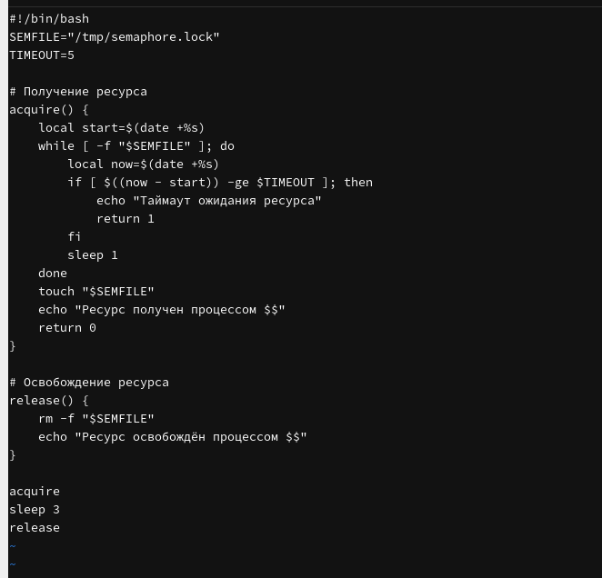{#fig-sem width=80%}

```bash
chmod +x semaphore.sh
ls -l semaphore.sh
```

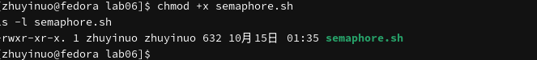{#fig-sem-chmod width=80%}

```bash
./semaphore.sh
```

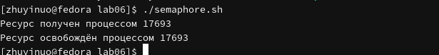{#fig-sem-run width=80%}

```bash
./semaphore.sh &
./semaphore.sh &
wait
```

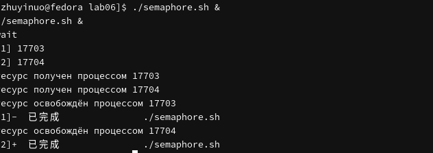{#fig-sem-two width=80%}

```bash
./semaphore.sh > /dev/tty2 &
./semaphore.sh > /dev/tty2 &
```

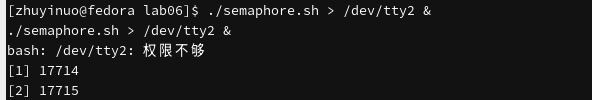{#fig-sem-tty width=80%}

## Скрипт 2: man

```bash
#!/bin/bash
MAN1="/usr/share/man/man1"
CMD=$1

if [ -z "$CMD" ]; then
    echo "Укажите имя команды"
    exit 1
fi

if [ -f "$MAN1/$CMD.1.gz" ]; then
    zcat "$MAN1/$CMD.1.gz" | less
elif [ -f "$MAN1/$CMD.1" ]; then
    less "$MAN1/$CMD.1"
else
    MANPAGE=$(find /usr/share/man -name "$CMD.*" -print -quit 2>/dev/null)
    if [ -n "$MANPAGE" ]; then
        man "$CMD" | less
    else
        echo "Справка для команды $CMD не найдена"
    fi
fi
```

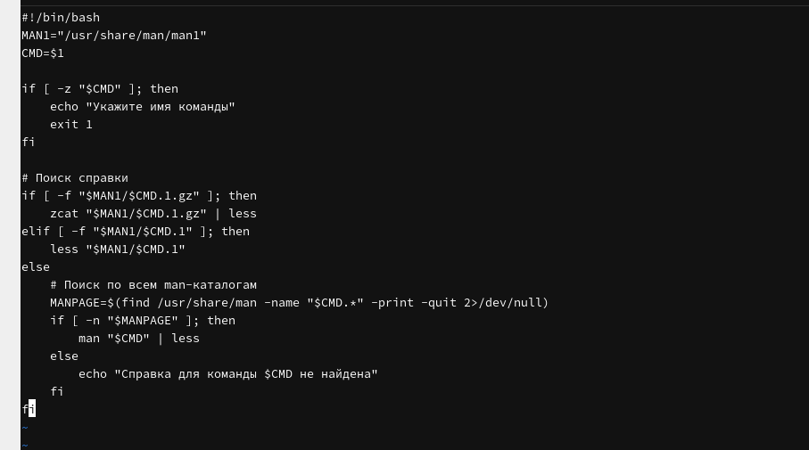{#fig-man width=80%}

```bash
chmod +x man_helper.sh
ls -l man_helper.sh
```

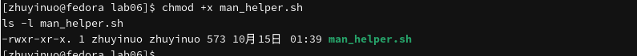{#fig-man-chmod width=80%}

```bash
./man_helper.sh ls
```

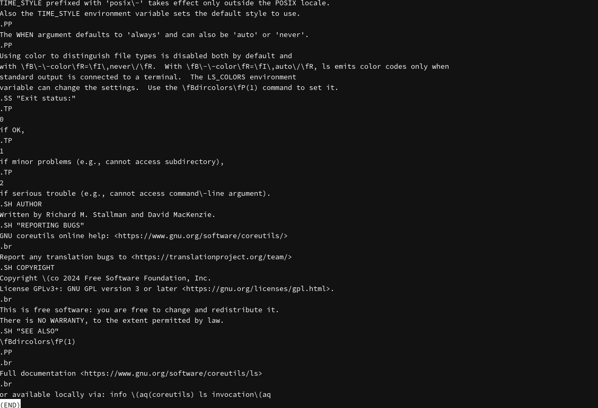{#fig-man-ls width=80%}

```bash
./man_helper.sh nonexistentcmd
```

{#fig-man-notfound width=80%}

## Скрипт 3: случайная строка

```bash
#!/bin/bash
LENGTH=${1:-10}

for i in $(seq 1 $LENGTH); do
    R=$((RANDOM % 52))
    if [ $R -lt 26 ]; then
        CODE=$((65 + R))
    else
        CODE=$((97 + R - 26))
    fi
    printf "\\$(printf '%03o' $CODE)"
done
echo
```

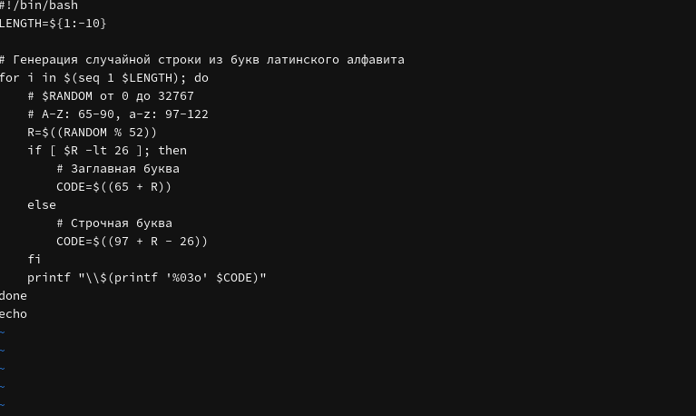{#fig-random width=80%}

```bash
chmod +x random_string.sh
ls -l random_string.sh
```

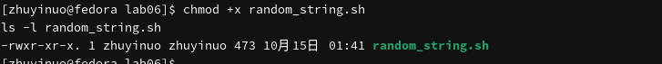{#fig-random-chmod width=80%}

```bash
./random_string.sh 10
```

{#fig-random-10 width=80%}

```bash
./random_string.sh 20
```

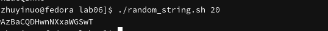{#fig-random-20 width=80%}

```bash
for i in 1 2 3; do ./random_string.sh 8; done
```

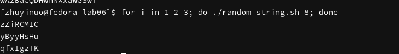{#fig-random-multi width=80%}

# Выводы

В ходе работы изучены расширенные возможности программирования в bash: механизм семафоров с файлом-замком, реализация команды `man` через `/usr/share/man`, генерация случайных строк с помощью `$RANDOM`.

# Контрольные вопросы

**1. Синтаксическая ошибка в строке.**

```bash
while [$1 != "exit"]
```

Отсутствуют пробелы после `[` и перед `]`. Правильно:

```bash
while [ $1 != "exit" ]
```

**2. Конкатенация строк.**

```bash
s3="$s1 $s2"
```

**3. Утилита seq.**

Генерирует последовательность чисел. Альтернативы: `for i in {1..10}`, `while`.

**4. Результат `$((10/3))`.**

`3` (целочисленное деление).

**5. Отличия zsh от bash.**

zsh имеет более мощное автодополнение, расширенные глоб-паттерны, более строгий синтаксис.

**6. Синтаксис `for ((a=1; a <= LIMIT; a++))`.**

Верен, это C-подобный цикл в bash.

**7. Сравнение bash с другими языками.**

Преимущества: простота, интеграция с ОС, работа с файлами. Недостатки: медленнее, слабая типизация, ограниченные структуры данных.

# Список литературы

1. Курячий К. В. Операционная система UNIX. — М. : ИНТУИТ, 2016.
2. Робачевский А., Немнюгин С., Стесик О. Операционная система UNIX. — БХВ-Петербург, 2010.
3. Колисниченко Д. Н. Самоучитель системного администратора Linux. — БХВ-Петербург, 2011.