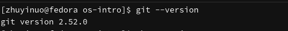
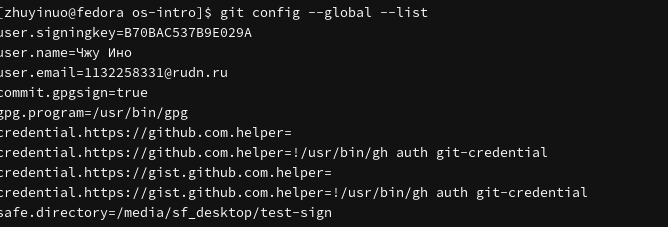
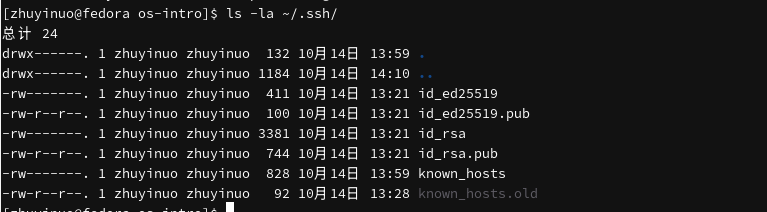
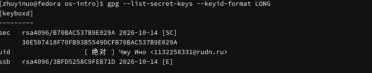
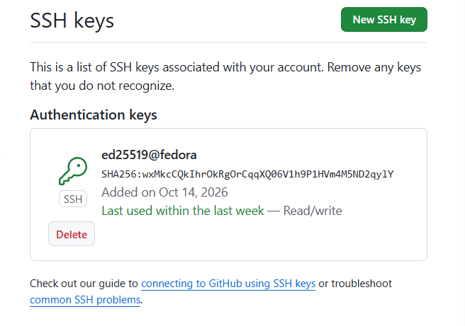
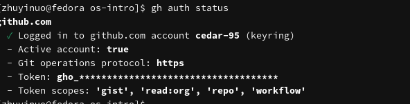
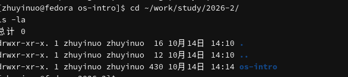
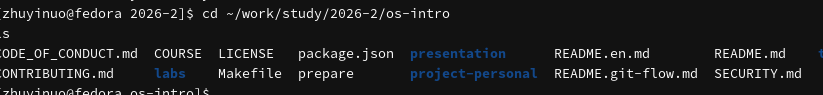
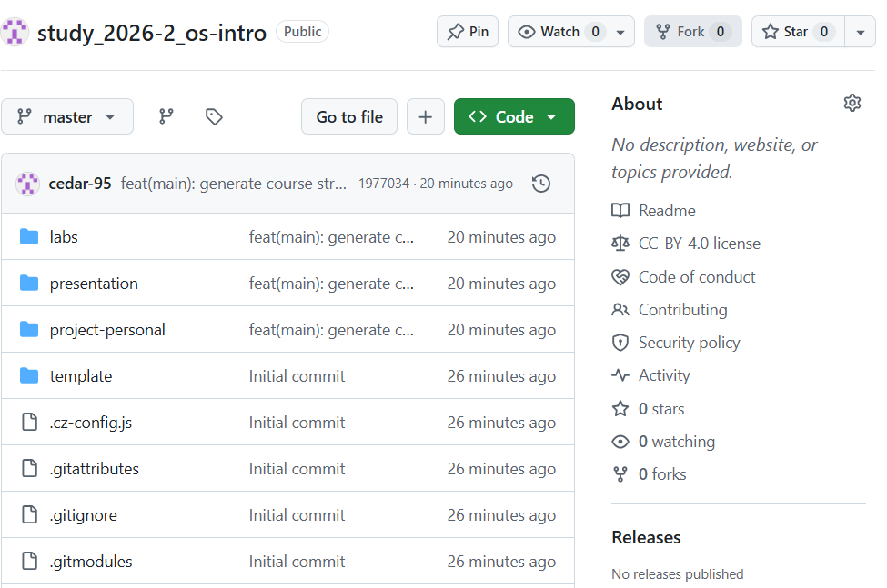

---
## Author
author:
  name: Чжу Ино
  affiliation:
    - name: Российский университет дружбы народов
      country: Российская Федерация
      postal-code: 117198
      city: Москва
      address: ул. Миклухо-Маклая, д. 6
## Title
title: Лабораторная работа № 2
subtitle:  Первоначальная настройка git
date: today
date-format: "YYYY-MM-DD"
format:
  beamer:
    theme: "Madrid"
    colortheme: "default"
    fonttheme: "professionalfonts"
    mainfont: "DejaVu Serif"
    sansfont: "DejaVu Sans"
    monofont: "DejaVu Sans Mono"
    lang: ru
    toc: false
    slide-level: 2
---

# Информация

## Докладчик

::: {.columns align=center}
::: {.column width="50%"}
- Чжу Ино
- группа НПИбд-03-25
- Российский университет дружбы народов им. П. Лумумбы
- Студенческий билет: 1132258331
:::
::: {.column width="50%"}
:::
:::

# Вводная часть

## Цель работы

- Изучить идеологию и применение средств контроля версий
- Освоить умения по работе с git

## Задачи

- Установить git и gh
- Выполнить базовую настройку git
- Создать ключи SSH
- Создать ключи PGP
- Настроить GitHub
- Добавить SSH-ключ в GitHub
- Настроить gh
- Создать репозиторий курса на основе шаблона

# Теоретические сведения

## Системы контроля версий

- VCS применяются при работе нескольких человек над одним проектом
- Позволяют фиксировать изменения, откатываться к предыдущим версиям
- Централизованные: CVS, Subversion
- Децентрализованные: Git, Bazaar, Mercurial

## Возможности Git

- Распределённая система контроля версий
- Набор программ командной строки
- Ветвление, слияние, работа с удалёнными репозиториями

# Выполнение лабораторной работы

## Установка ПО

```bash
sudo dnf -y install git
sudo dnf -y install gh
```



## Базовая настройка git

```bash
git config --global user.name "Чжу Ино"
git config --global user.email "1132258331@rudn.ru"
git config --global core.quotepath false
git config --global init.defaultBranch master
git config --global core.autocrlf input
git config --global core.safecrlf warn
```



## Создание ключей SSH

- RSA 4096 бит
- Ed25519



## Создание ключей PGP

- RSA 4096 бит



## Настройка GitHub

- Добавлен SSH-ключ
- Добавлен PGP-ключ
- Настроены автоматические подписи



## Настройка gh

```bash
gh auth login
```



## Создание репозитория курса

```bash
gh repo create study_2026-2_os-intro --template=yamadharma/course-directory-student-template --public
git clone --recursive git@github.com:cedar-95/study_2026-2_os-intro.git os-intro
```



## Настройка каталога курса

```bash
echo os-intro > COURSE
make prepare
```





# Результаты

## Результаты работы

- Установлены git и gh
- Выполнена базовая настройка git
- Созданы ключи SSH и PGP
- Настроен GitHub
- Настроен gh
- Создан репозиторий курса

# Заключение

## Главный вывод

В ходе работы изучена идеология VCS, освоены навыки работы с git: настройка, ключи, GitHub, gh, создание репозитория курса.