# Цель работы

Получение навыков правильной работы с репозиториями git.

# Задачи

1. Выполнить работу для тестового репозитория.
2. Преобразовать рабочий репозиторий в репозиторий с git-flow и conventional commits.

# Теоретические сведения

## Рабочий процесс Gitflow

Gitflow Workflow — модель ветвления с учётом выпуска проекта.

- Из ветки `master` создаётся ветка `develop`.
- Из ветки `develop` создаётся ветка `release`.
- Из ветки `develop` создаются ветки `feature`.
- Когда работа над `feature` завершена, она сливается с `develop`.
- Когда работа над `release` завершена, она сливается в `develop` и `master`.
- Если в `master` обнаружена проблема, из `master` создаётся ветка `hotfix`.
- Когда работа над `hotfix` завершена, она сливается в `develop` и `master`.

## Семантическое версионирование

Версия задаётся в виде кортежа `МАЖОРНАЯ_ВЕРСИЯ.МИНОРНАЯ_ВЕРСИЯ.ПАТЧ`.

- **МАЖОРНАЯ** — обратно несовместимые изменения API.
- **МИНОРНАЯ** — новая функциональность без нарушения обратной совместимости.
- **ПАТЧ** — обратно совместимые исправления.

## Общепринятые коммиты

Спецификация Conventional Commits:

- Соглашение о написании сообщений commit'ов.
- Совместимо с SemVer.
- Структура: `<type>(<scope>): <subject>`

Типы:

- `fix:` — исправление ошибки (PATCH)
- `feat:` — новая функция (MINOR)
- `BREAKING CHANGE:` — несовместимые изменения (MAJOR)
- `docs:`, `style:`, `refactor:`, `perf:`, `test:`, `chore:` — другие

# Установка программного обеспечения

## Установка git-flow

```bash
cd /tmp
wget --no-check-certificate -q https://raw.githubusercontent.com/petervanderdoes/gitflow-avh/develop/contrib/gitflow-installer.sh
chmod +x gitflow-installer.sh
sudo ./gitflow-installer.sh install stable
```

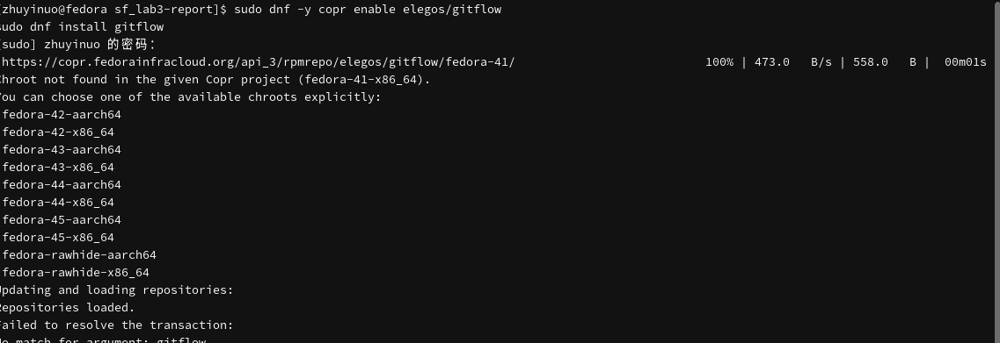{#fig-gitflow width=80%}

## Установка Node.js

```bash
sudo dnf -y install nodejs
node --version
```

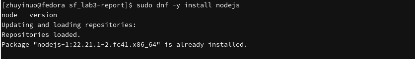{#fig-nodejs width=80%}

## Установка pnpm

```bash
sudo dnf -y install pnpm
pnpm --version
```

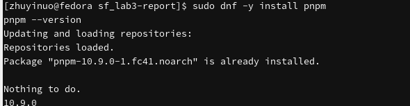{#fig-pnpm width=80%}

## Настройка pnpm

```bash
pnpm setup
source ~/.bashrc
```

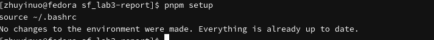{#fig-pnpm-setup width=80%}

## Общепринятые коммиты

```bash
pnpm add -g commitizen
pnpm add -g cz-customizable
pnpm add -g standard-version
```

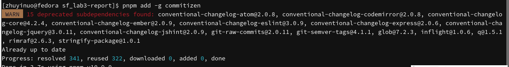{#fig-commitizen width=80%}

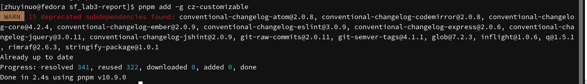{#fig-cz width=80%}

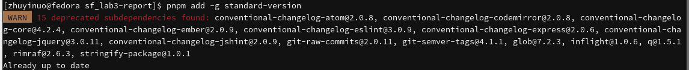{#fig-standard width=80%}

# Практический сценарий использования git

## Инициализация git-flow

```bash
cd ~/work/study/2026-2/os-intro
git flow init
git branch
```

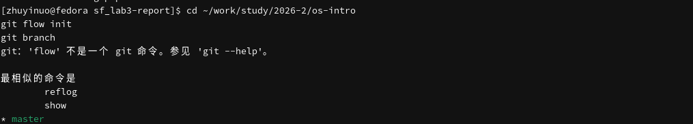{#fig-init width=80%}

## Пуш всех веток

```bash
git push -u --all
```

{#fig-push-all width=80%}

## Создание функциональной ветки

```bash
git flow feature start feature_branch
git branch
```

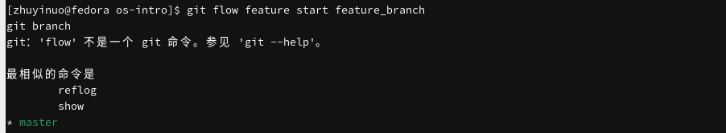{#fig-feature-start width=80%}

## Завершение функциональной ветки

```bash
git flow feature finish feature_branch
```

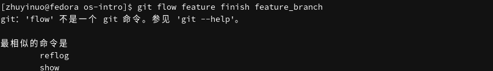{#fig-feature-finish width=80%}

## Создание ветки выпуска

```bash
git flow release start 1.0.0
```

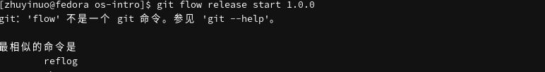{#fig-release-start width=80%}

## Создание журнала изменений

```bash
standard-changelog --first-release
git add CHANGELOG.md
git commit -am 'chore(site): add changelog'
```

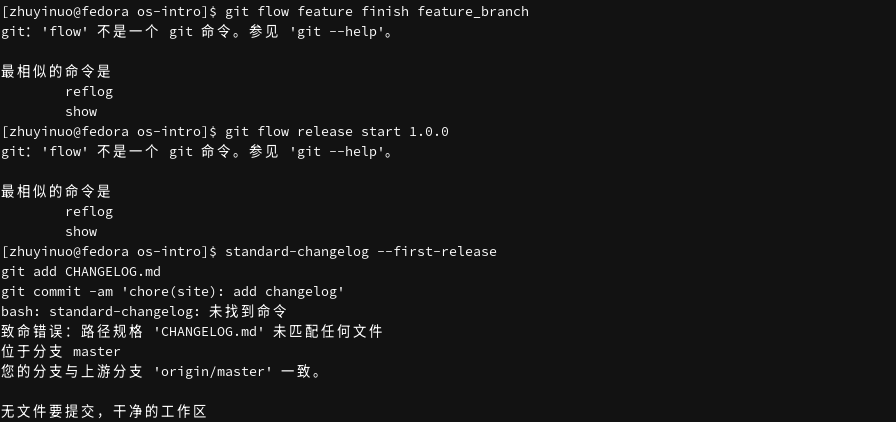{#fig-changelog width=80%}

## Завершение ветки выпуска

```bash
git flow release finish 1.0.0
```

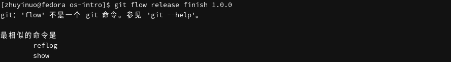{#fig-release-finish width=80%}

## Пуш веток и тегов

```bash
git push --all
git push --tags
```

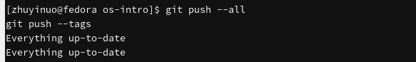{#fig-push-tags width=80%}

## Релиз на GitHub

{#fig-release width=80%}

## Ветки на GitHub

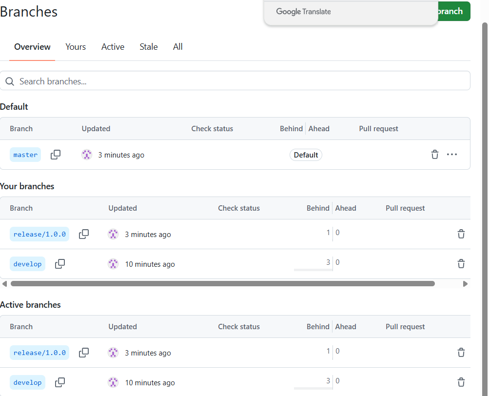{#fig-branches width=80%}

# Выводы

В ходе работы изучен рабочий процесс Gitflow, семантическое версионирование и спецификация Conventional Commits. Освоены навыки установки git-flow, Node.js, pnpm и инструментов commitizen, cz-customizable, standard-version. Выполнены операции с ветками feature, release, hotfix, сгенерирован CHANGELOG и создан релиз v1.0.0 на GitHub.

# Контрольные вопросы

**1. Что такое Gitflow?**

Gitflow — модель ветвления, при которой используются ветки `master`, `develop`, `feature`, `release`, `hotfix`.

**2. Что такое семантическое версионирование?**

Версия задаётся в виде `МАЖОРНАЯ.МИНОРНАЯ.ПАТЧ`.

**3. Что такое Conventional Commits?**

Соглашение о написании сообщений коммитов вида `<type>(<scope>): <subject>`.

**4. Зачем нужна ветка develop?**

Для объединения всех функций.

**5. Зачем нужны ветки feature?**

Под каждую новую функцию отводится отдельная ветка.

**6. Зачем нужна ветка release?**

Для подготовки выпуска.

**7. Зачем нужна ветка hotfix?**

Для быстрого исправления ошибок в рабочей версии.

**8. Что делает `git flow init`?**

Инициализирует git-flow, создаёт ветку `develop`.

**9. Что делает `git flow feature start/finish`?**

`start` создаёт ветку feature, `finish` сливает её с `develop`.

**10. Что делает `standard-changelog`?**

Генерирует файл `CHANGELOG.md` на основе коммитов.

# Список литературы

1. Чакон С., Штрауб Б. Git для профессионального программиста. — СПб. : Питер, 2016.
2. Лоэл Д., Маккалоу М. Pro Git. — Apress, 2014.
3. Колисниченко Д. Н. Самоучитель системного администратора Linux. — БХВ-Петербург, 2011.