---
## Author
author:
  name: Чжу Ино
  affiliation:
    - name: Российский университет дружбы народов
      country: Российская Федерация
      postal-code: 117198
      city: Москва
      address: ул. Миклухо-Маклая, д. 6
## Title
title: Лабораторная работа № 5
subtitle:  Настройка рабочей среды
date: today
date-format: "YYYY-MM-DD"
format:
  beamer:
    theme: "Madrid"
    colortheme: "default"
    lang: ru
    toc: false
    slide-level: 2
    mainfont: "DejaVu Serif"
    sansfont: "DejaVu Sans"
    monofont: "DejaVu Sans Mono"
  html:
    embed-resources: true
---

# Информация

## Докладчик

::: {.columns align=center}
::: {.column width="50%"}
- Чжу Ино
- группа НПИбд-03-25
- Российский университет дружбы народов им. П. Лумумбы
- Студенческий билет: 1132258331
:::
::: {.column width="50%"}
:::
:::

# Вводная часть

## Цель работы

- Настройка рабочей среды: менеджер паролей pass, chezmoi, дополнительное ПО

## Задачи

- Установить и настроить pass
- Освоить управление файлами конфигурации с помощью chezmoi
- Установить дополнительное программное обеспечение

# Теоретические сведения

## Менеджер паролей pass

- `pass` — программа в рамках идеологии Unix
- Данные хранятся в файловой системе
- Файлы шифруются с помощью GPG-ключа

## Структура базы паролей

- Произвольная структура
- Примеры имён файлов:
  - `example.com.pgp`
  - `example.com/user.pgp`
  - `user@example.com.pgp`

## chezmoi

- Управление файлами конфигурации домашнего каталога
- Состояние в `~/.local/share/chezmoi`
- Конфигурация в `~/.config/chezmoi/chezmoi.toml`

# Выполнение лабораторной работы

## Установка pass

```bash
sudo dnf -y install pass pass-otp
pass --version
```

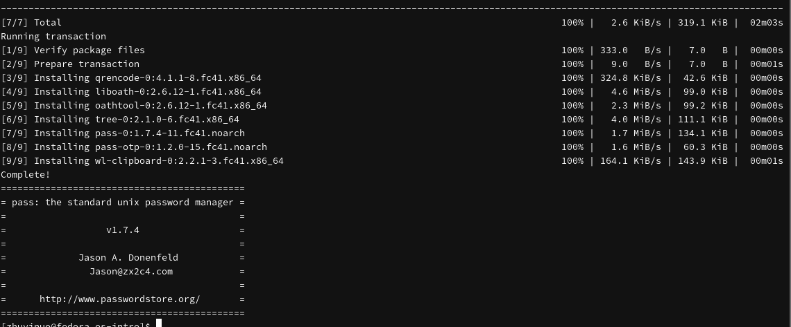

## Установка gopass

```bash
sudo dnf -y install gopass
```

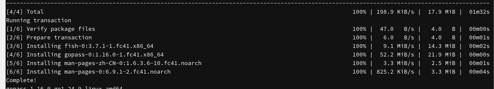

## Ключи GPG

```bash
gpg --list-secret-keys
```

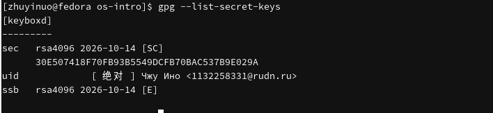

## Инициализация pass

```bash
pass init 1132258331@rudn.ru
pass git init
```

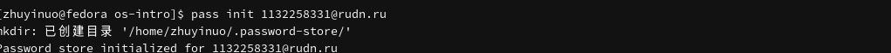

## Синхронизация с git

```bash
gh repo create password-store --private
pass git remote add origin git@github.com:cedar-95/password-store.git
pass git push -u origin master
```

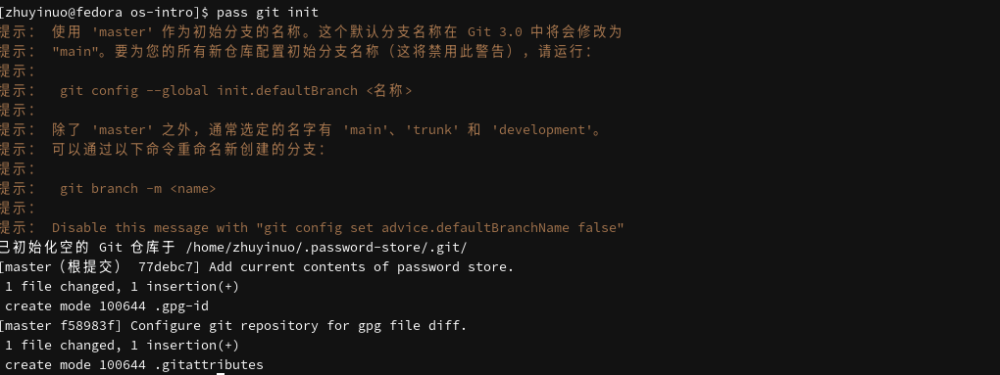

## Установка chezmoi

```bash
sudo dnf -y install chezmoi
chezmoi --version
```

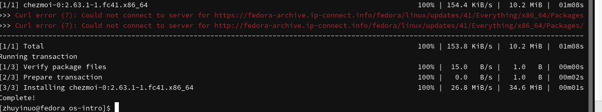

## Дополнительное ПО

```bash
sudo dnf -y install dunst fontawesome-fonts powerline-fonts light fuzzel swaylock kitty waybar swaybg wl-clipboard grim slurp
```

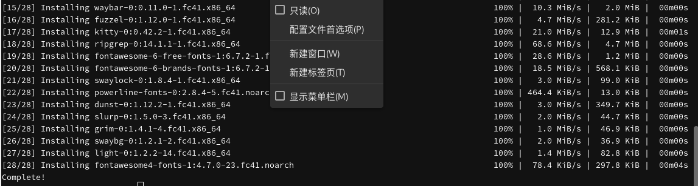

## Создание dotfiles

```bash
gh repo create dotfiles --template="yamadharma/dotfiles-template" --private
```

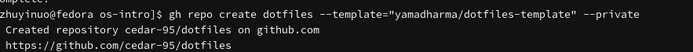

## Инициализация chezmoi

```bash
chezmoi init git@github.com:cedar-95/dotfiles.git
chezmoi diff
chezmoi apply -v
```

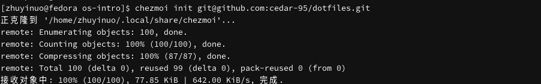

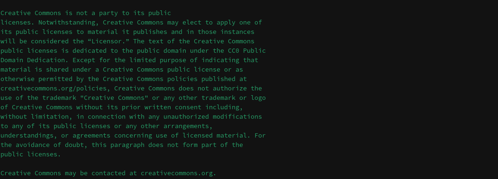

## Сохранение пароля

```bash
pass insert example.com/user
pass example.com/user
```

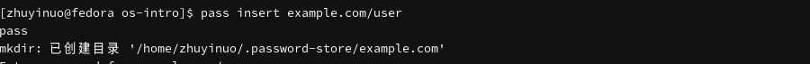

## Репозитории на GitHub

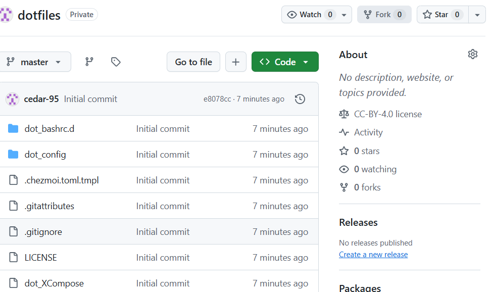

# Результаты

## Результаты работы

- Установлен и настроен pass
- Освоено управление файлами конфигурации с помощью chezmoi
- Установлено дополнительное ПО

# Заключение

## Главный вывод

Освоены навыки настройки рабочей среды: pass, chezmoi, дополнительное программное обеспечение.