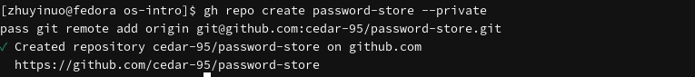
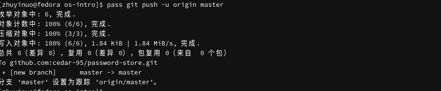
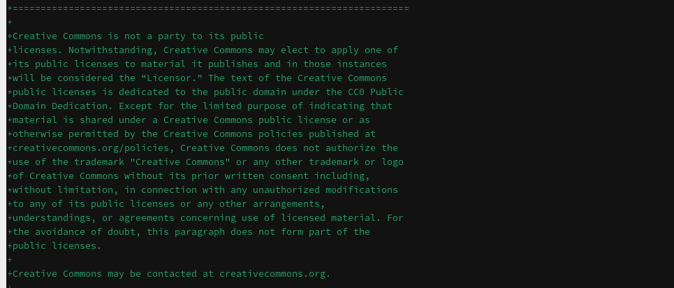
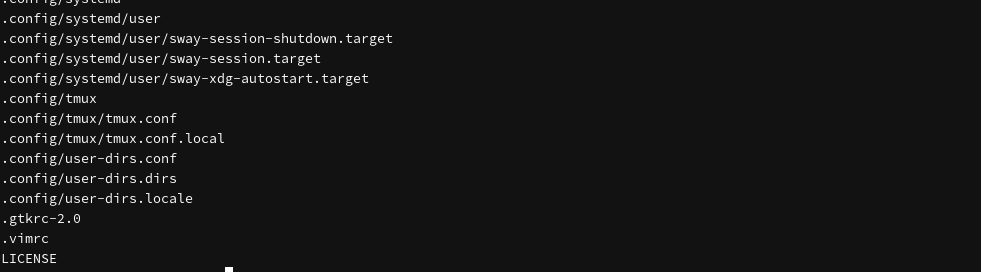
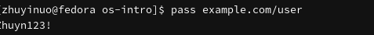

# Цель работы

Настройка рабочей среды: менеджер паролей pass, управление файлами конфигурации chezmoi, дополнительное программное обеспечение.

# Задачи

1. Установить и настроить менеджер паролей pass.
2. Освоить управление файлами конфигурации с помощью chezmoi.
3. Установить дополнительное программное обеспечение.

# Теоретические сведения

## Менеджер паролей pass

- `pass` — программа, сделанная в рамках идеологии Unix.
- Данные хранятся в файловой системе в виде каталогов и файлов.
- Файлы шифруются с помощью GPG-ключа.

## Структура базы паролей

- Структура базы может быть произвольной.
- Примеры имён файлов:
  - `example.com.pgp`
  - `example.com/user.pgp`
  - `user@example.com.pgp`
  - `example.com:22.pgp`

## Управление файлами конфигурации chezmoi

- `chezmoi` используется для управления файлами конфигурации домашнего каталога пользователя.
- Состояние файлов конфигурации сохраняется в каталоге `~/.local/share/chezmoi`.
- Файл конфигурации `~/.config/chezmoi/chezmoi.toml`.

# Выполнение лабораторной работы

## Установка pass

```bash
sudo dnf -y install pass pass-otp
pass --version
```

{#fig-pass width=80%}

## Установка gopass

```bash
sudo dnf -y install gopass
gopass --version
```

{#fig-gopass width=80%}

## Ключи GPG

```bash
gpg --list-secret-keys
```

{#fig-gpg width=80%}

## Инициализация pass

```bash
pass init 1132258331@rudn.ru
```

{#fig-pass-init width=80%}

## Синхронизация с git

```bash
pass git init
gh repo create password-store --private
pass git remote add origin git@github.com:cedar-95/password-store.git
pass git push -u origin master
```

{#fig-pass-git width=80%}

{#fig-pass-repo width=80%}

{#fig-pass-push width=80%}

## Установка chezmoi

```bash
sudo dnf -y install chezmoi
chezmoi --version
```

{#fig-chezmoi width=80%}

## Дополнительное ПО

```bash
sudo dnf -y install \
    dunst \
    fontawesome-fonts \
    powerline-fonts \
    light \
    fuzzel \
    swaylock \
    kitty \
    waybar swaybg \
    wl-clipboard \
    grim \
    slurp
```

{#fig-extra width=80%}

## Создание репозитория dotfiles

```bash
gh repo create dotfiles --template="yamadharma/dotfiles-template" --private
```

{#fig-dotfiles width=80%}

## Инициализация chezmoi

```bash
chezmoi init git@github.com:cedar-95/dotfiles.git
chezmoi diff
chezmoi apply -v
```

{#fig-chezmoi-init width=80%}

{#fig-chezmoi-diff width=80%}

{#fig-chezmoi-apply width=80%}

## Статус chezmoi

```bash
chezmoi managed
chezmoi status
```

{#fig-chezmoi-status width=80%}

## Сохранение пароля

```bash
pass insert example.com/user
```

{#fig-pass-insert width=80%}

```bash
pass example.com/user
```

{#fig-pass-show width=80%}

## Репозитории на GitHub

{#fig-repos width=80%}

# Выводы

В ходе работы освоены навыки настройки рабочей среды: установлен и настроен менеджер паролей pass, освоено управление файлами конфигурации с помощью chezmoi, установлено дополнительное программное обеспечение.

# Контрольные вопросы

**1. Что такое менеджер паролей pass?**

`pass` — программа для хранения паролей, использующая файловую систему и GPG-шифрование.

**2. Как хранятся данные в pass?**

В файловой системе в виде каталогов и файлов, зашифрованных GPG.

**3. Какие есть реализации pass?**

- `pass` — классическая реализация на shell.
- `gopass` — реализация на Go.

**4. Что такое chezmoi?**

`chezmoi` — утилита для управления файлами конфигурации домашнего каталога.

**5. Где хранится состояние chezmoi?**

В каталоге `~/.local/share/chezmoi`.

**6. Как инициализировать chezmoi?**

```bash
chezmoi init git@github.com:<username>/dotfiles.git
```

**7. Как применить изменения chezmoi?**

```bash
chezmoi apply -v
```

**8. Как посмотреть различия chezmoi?**

```bash
chezmoi diff
```

**9. Что такое dotfiles?**

Файлы конфигурации в домашнем каталоге (`.bashrc`, `.vimrc` и т. д.).

**10. Зачем нужно дополнительное ПО?**

Для настройки рабочей среды: уведомления, шрифты, блокировка экрана, работа с буфером обмена.

# Список литературы

1. Уокер Д. Управление конфигурацией с помощью chezmoi. — 2023.
2. Чакон С., Штрауб Б. Git для профессионального программиста. — СПб. : Питер, 2016.
3. Колисниченко Д. Н. Самоучитель системного администратора Linux. — БХВ-Петербург, 2011.