# Цель работы

Приобретение практических навыков взаимодействия пользователя с системой посредством командной строки.

# Задачи

1. Определить полное имя домашнего каталога.
2. Выполнить операции с каталогами `/tmp`, `/var/spool`.
3. Создать и удалить каталоги `newdir`, `morefun`, `letters`, `memos`, `misk`.
4. С помощью `man` определить опции команд `ls`, `cd`, `pwd`, `mkdir`, `rmdir`, `rm`.
5. Использовать `history` для модификации и исполнения команд.

# Теоретические сведения

## Формат команды

```
<имя_команды> <разделитель> <аргументы>
```

## Команда man

```bash
man <команда>
```

Управление: `Space` — страница вперёд, `Enter` — строка вперёд, `q` — выход.

## Команда cd

```bash
cd [путь_к_каталогу]
```

## Команда ls

```bash
ls [-опции] [путь]
```

- `-a` — показать скрытые файлы
- `-F` — показать тип файла
- `-l` — подробная информация
- `-R` — рекурсивно

## Команда mkdir

```bash
mkdir имя_каталога1 [имя_каталога2...]
```

- `-m` — атрибуты доступа
- `-p` — создать родительские каталоги

## Команда rm

```bash
rm [-опции] [файл]
```

- `-i` — подтверждение
- `-r` — рекурсивно

## Команда history

```bash
history
!<номер>
!<номер>:s/<что_меняем>/<на_что_меняем>
```

# Выполнение лабораторной работы

## Определение домашнего каталога

```bash
pwd
```

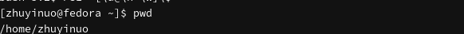{#fig-pwd width=80%}

## Работа с каталогом /tmp

```bash
cd /tmp
ls
```

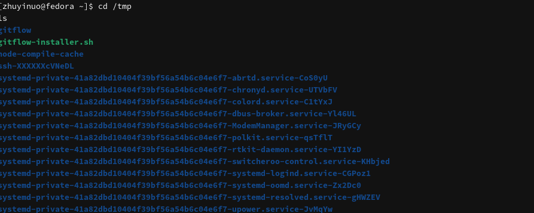{#fig-tmp width=80%}

## Опции команды ls

```bash
ls -a
ls -F
ls -l
ls -alF
```

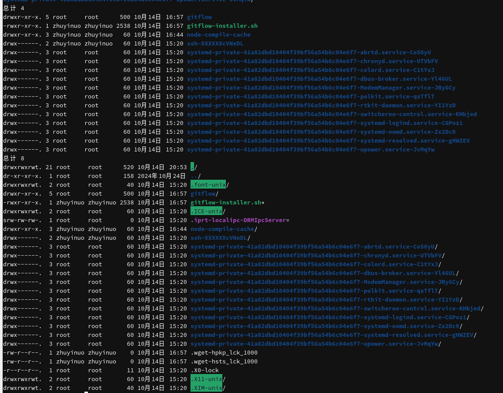{#fig-ls-options width=80%}

## Проверка /var/spool

```bash
ls /var/spool/
ls /var/spool/cron
```

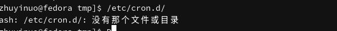{#fig-spool width=80%}

Подкаталог `cron` в `/var/spool` отсутствует.

## Домашний каталог

```bash
cd ~
pwd
ls -la
```

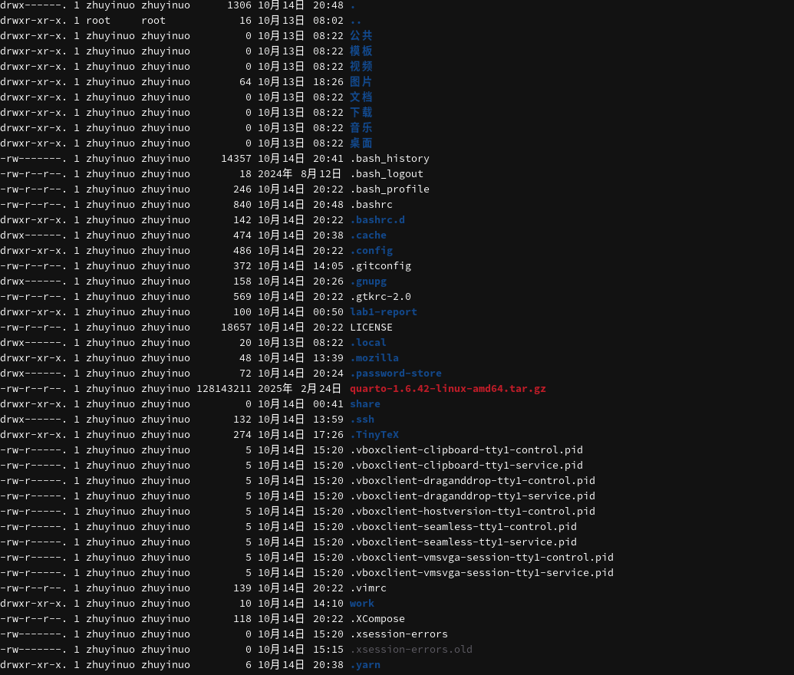{#fig-home width=80%}

## Создание каталогов newdir и morefun

```bash
mkdir ~/newdir
mkdir ~/newdir/morefun
ls -la ~/newdir
```

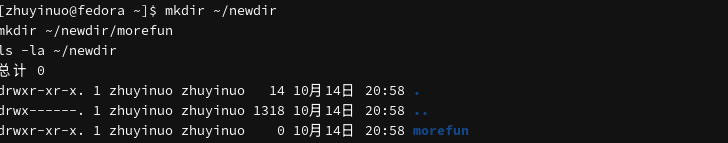{#fig-newdir width=80%}

## Создание трёх каталогов

```bash
cd ~
mkdir letters memos misk
ls
```

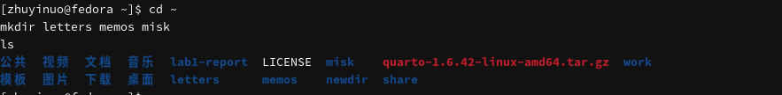{#fig-three width=80%}

## Удаление трёх каталогов

```bash
rmdir letters memos misk
ls
```

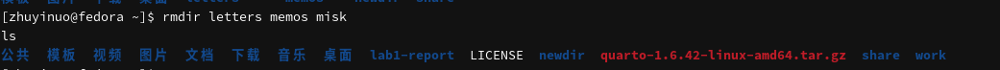{#fig-rmdir-three width=80%}

## Попытка удалить newdir командой rm

```bash
rm ~/newdir
ls ~/
```

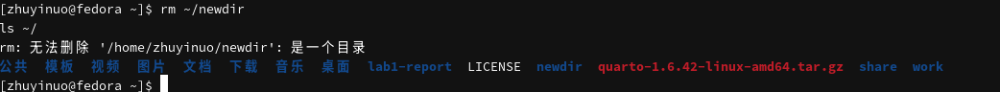{#fig-rm-newdir width=80%}

Каталог не был удалён, так как `rm` без опции `-r` не удаляет каталоги.

## Удаление morefun

```bash
rmdir ~/newdir/morefun
ls ~/newdir
```

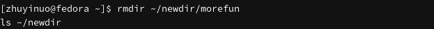{#fig-morefun width=80%}

## Опция ls -R

```bash
man ls
```

Опция `-R` позволяет просмотреть содержимое указанного каталога и всех подкаталогов.

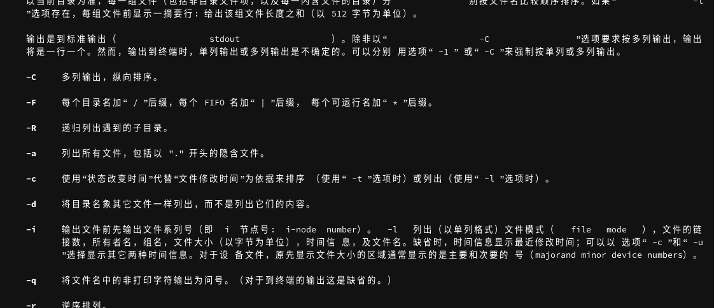{#fig-man-R width=80%}

## Опции ls -lt

```bash
man ls
```

Опции `-l` и `-t` позволяют вывести подробную информацию с сортировкой по времени последнего изменения.

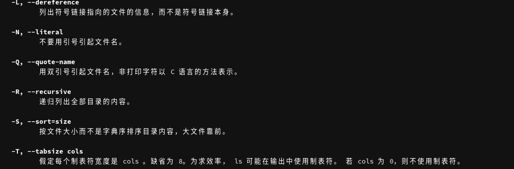{#fig-man-lt width=80%}

## man cd и pwd

```bash
man cd
man pwd
```

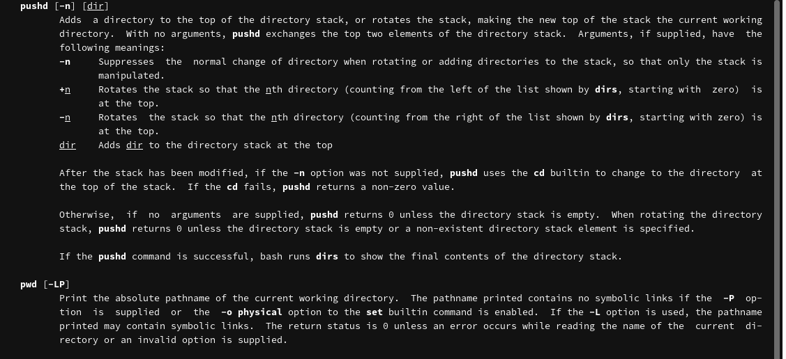{#fig-man-cd width=80%}

## man mkdir, rmdir, rm

```bash
man mkdir
man rmdir
man rm
```

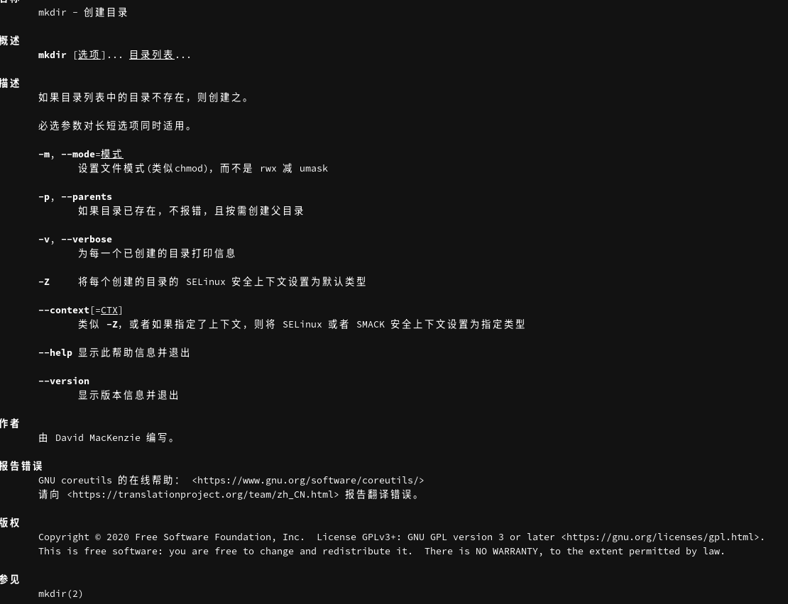{#fig-man-mkdir width=80%}

## history

```bash
history
```

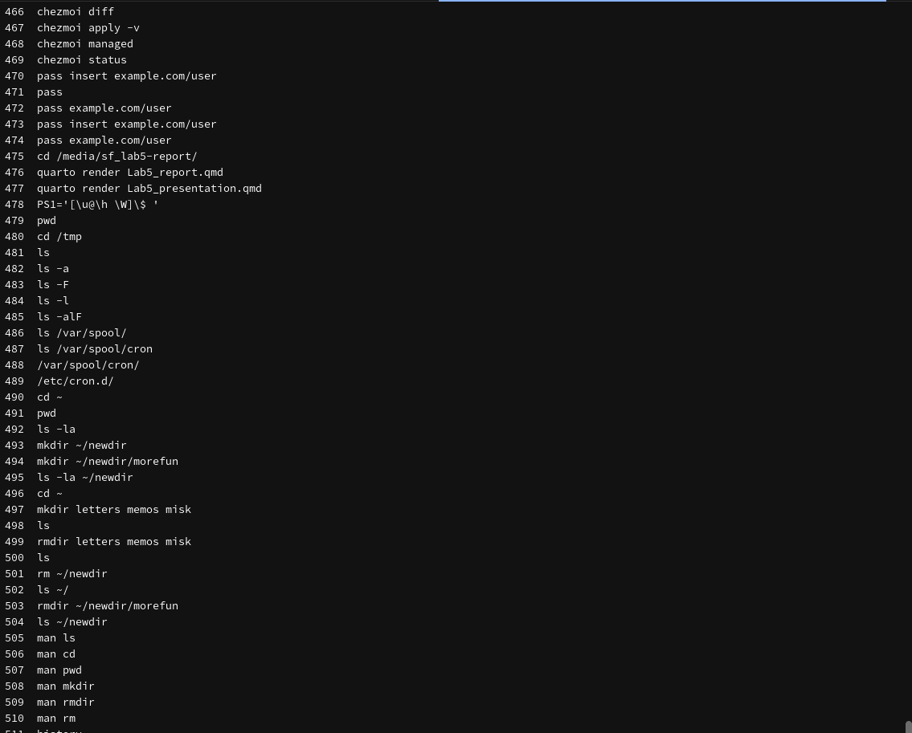{#fig-history width=80%}

## Повтор команды

```bash
!5
```

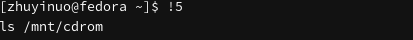{#fig-repeat width=80%}

## Модификация команды

```bash
!3:s/a/F
```

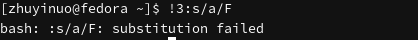{#fig-modify width=80%}

# Выводы

В ходе работы приобретены практические навыки взаимодействия с системой Unix посредством командной строки: изучены команды `man`, `cd`, `ls`, `mkdir`, `rm`, `rmdir`, `history`, освоены их основные опции.

# Контрольные вопросы

**1. Что такое командная строка?**

Интерфейс взаимодействия пользователя с системой посредством ввода команд.

**2. Как определить абсолютный путь текущего каталога?**

```bash
pwd
```

**3. Как определить тип файлов и их имена?**

```bash
ls -F
```

**4. Как отобразить скрытые файлы?**

```bash
ls -a
```

**5. Как удалить файл и каталог?**

- Файл: `rm file`
- Пустой каталог: `rmdir dir`
- Каталог с файлами: `rm -r dir`

Одной командой — `rm -r`.

**6. Как вывести последние выполненные команды?**

```bash
history
```

**7. Как модифицированно выполнить команду из истории?**

```bash
!<номер>:s/<что_меняем>/<на_что_меняем>
```

**8. Примеры запуска нескольких команд в одной строке.**

```bash
cd ~ && ls -la
mkdir dir1; mkdir dir2
```

**9. Символы экранирования.**

`\`, `'`, `"`, `$`, `` ` ``.

**10. Вывод команды ls -l.**

Тип файла, права доступа, число ссылок, владелец, размер, дата, имя.

**11. Относительный путь.**

Путь относительно текущего каталога: `../dir1`, `./file`.

**12. Как получить информацию о команде?**

```bash
man <команда>
```

**13. Клавиша автодополнения.**

`Tab`.

# Список литературы

1. Робачевский А., Немнюгин С., Стесик О. Операционная система UNIX. — БХВ-Петербург, 2010.
2. Колисниченко Д. Н. Самоучитель системного администратора Linux. — БХВ-Петербург, 2011.
3. Таненбаум Э., Бос Х. Современные операционные системы. — Питер, 2015.