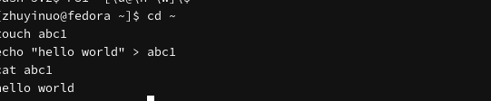
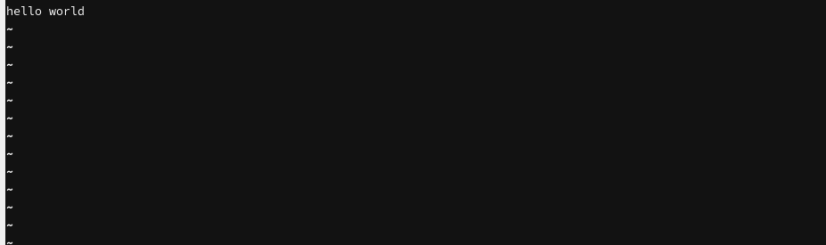
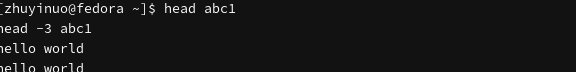
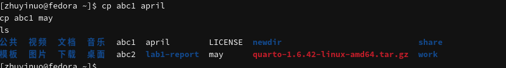
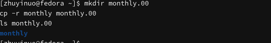
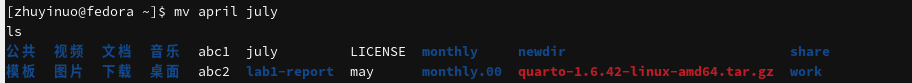
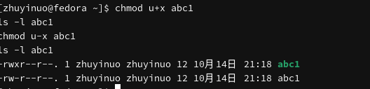
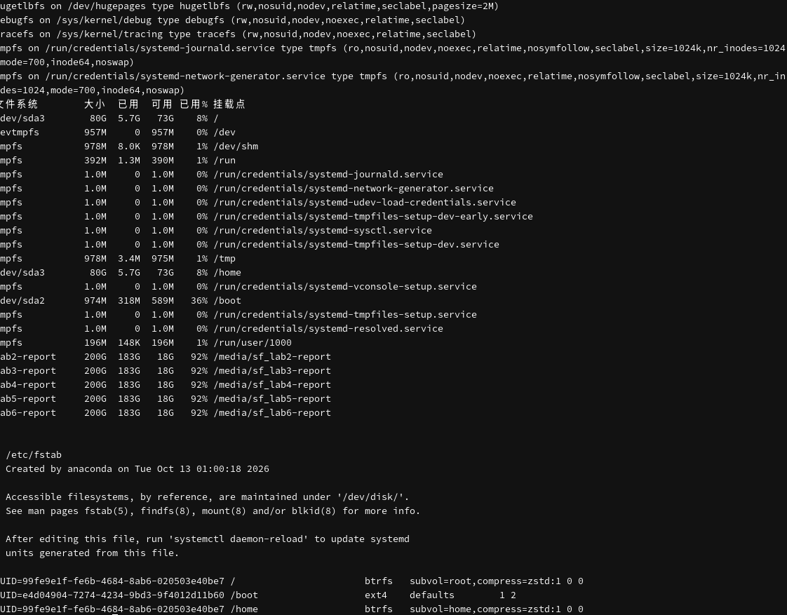

---
## Author
author:
  name: Чжу Ино
  affiliation:
    - name: Российский университет дружбы народов
      country: Российская Федерация
      postal-code: 117198
      city: Москва
      address: ул. Миклухо-Маклая, д. 6
## Title
title: Лабораторная работа № 7
subtitle:  Анализ файловой системы Linux
date: today
date-format: "YYYY-MM-DD"
format:
  beamer:
    theme: "Madrid"
    colortheme: "default"
    lang: ru
    toc: false
    slide-level: 2
    mainfont: "DejaVu Serif"
    sansfont: "DejaVu Sans"
    monofont: "DejaVu Sans Mono"
  html:
    embed-resources: true
---

# Информация

## Докладчик

::: {.columns align=center}
::: {.column width="50%"}
- Чжу Ино
- группа НПИбд-03-25
- Российский университет дружбы народов им. П. Лумумбы
- Студенческий билет: 1132258331
:::
::: {.column width="50%"}
:::
:::

# Вводная часть

## Цель работы

- Ознакомление с файловой системой Linux
- Приобретение навыков работы с файлами и каталогами

## Задачи

- Изучить команды для работы с файлами
- Освоить копирование, перемещение, переименование
- Изучить права доступа и `chmod`
- Проанализировать файловую систему

# Теоретические сведения

## Команды для файлов

- `touch` — создание
- `cat` — просмотр
- `less` — постраничный просмотр
- `head`, `tail` — первые/последние строки

## Копирование и перемещение

- `cp` — копирование
- `cp -r` — рекурсивное копирование
- `mv` — перемещение и переименование

## Права доступа

- `r` — чтение
- `w` — запись
- `x` — выполнение
- `chmod` — изменение прав

## Анализ файловой системы

- `mount`
- `df -h`
- `cat /etc/fstab`
- `fsck`

# Выполнение лабораторной работы

## Создание и просмотр файла

```bash
touch abc1
echo "hello world" > abc1
cat abc1
```



## Постраничный просмотр

```bash
less abc1
```



## head и tail

```bash
head abc1
tail abc1
```



## Копирование файла

```bash
cp abc1 april
cp abc1 may
```



## Копирование каталога

```bash
mkdir monthly.00
cp -r monthly monthly.00
cp -r monthly.00 /tmp
```



## Переименование и перемещение

```bash
mv april july
mv july monthly.00
mv monthly.00 monthly.01
mkdir reports
mv monthly.01 reports
```



## chmod

```bash
chmod u+x abc1
chmod 755 may
ls -l abc1 may
```



## Файловая система

```bash
mount | head -20
df -h
cat /etc/fstab
```



# Результаты

## Результаты работы

- Изучены команды работы с файлами
- Освоены копирование, перемещение, переименование
- Изучены права доступа и `chmod`
- Проанализирована файловая система

# Заключение

## Главный вывод

Изучена файловая система Linux, освоены команды работы с файлами и каталогами, права доступа, анализ файловой системы.