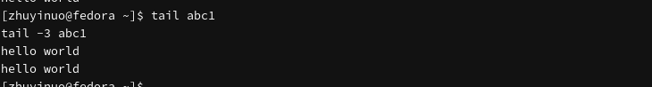
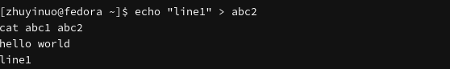
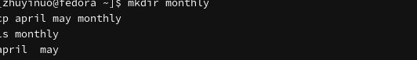
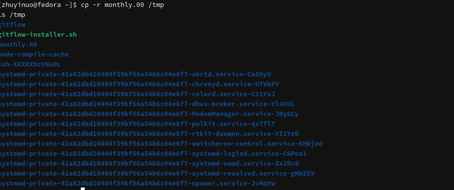
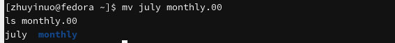
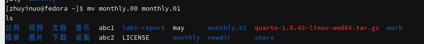
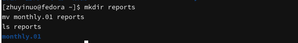
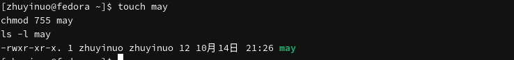
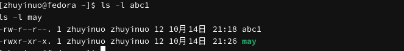

# Цель работы

Ознакомление с файловой системой Linux, её структурой, именами и содержанием каталогов. Приобретение практических навыков по применению команд для работы с файлами и каталогами, по управлению процессами, по проверке использования диска и обслуживанию файловой системы.

# Задачи

1. Изучить команды для работы с файлами и каталогами.
2. Освоить копирование, перемещение и переименование файлов и каталогов.
3. Изучить права доступа и команду `chmod`.
4. Проанализировать файловую систему.

# Теоретические сведения

## Команды для работы с файлами

- `touch имя_файла` — создание файла
- `cat имя_файла` — просмотр файла
- `less имя_файла` — постраничный просмотр
- `head [-n] имя_файла` — первые n строк
- `tail [-n] имя_файла` — последние n строк

## Копирование

```bash
cp [-опции] исходный_файл целевой_файл
```

- `-i` — запрос подтверждения
- `-r` — рекурсивное копирование каталогов

## Перемещение и переименование

```bash
mv [-опции] старый_файл новый_файл
```

## Права доступа

Каждый файл или каталог имеет права:

- тип файла (`-` — файл, `d` — каталог)
- права владельца (`rwx`)
- права группы (`rwx`)
- права остальных (`rwx`)

## Изменение прав доступа

```bash
chmod режим имя_файла
```

- `u` — владелец
- `g` — группа
- `o` — остальные
- `+` — дать право
- `-` — лишить права
- `=` — установить право

Числовая запись: `7` = `rwx`, `6` = `rw-`, `5` = `r-x`, `4` = `r--`.

## Анализ файловой системы

- `mount` — просмотр смонтированных файловых систем
- `cat /etc/fstab` — таблица файловых систем
- `df` — объём свободного пространства
- `fsck` — проверка целостности

# Выполнение лабораторной работы

## Создание и просмотр файла

```bash
cd ~
touch abc1
echo "hello world" > abc1
cat abc1
```

{#fig-touch width=80%}

## Постраничный просмотр

```bash
less abc1
```

{#fig-less width=80%}

## Команда head

```bash
head abc1
head -3 abc1
```

{#fig-head width=80%}

## Команда tail

```bash
tail abc1
tail -3 abc1
```

{#fig-tail width=80%}

## Несколько файлов

```bash
echo "line1" > abc2
cat abc1 abc2
```

{#fig-cat-two width=80%}

## Копирование файла

```bash
cp abc1 april
cp abc1 may
ls
```

{#fig-cp width=80%}

## Копирование нескольких файлов

```bash
mkdir monthly
cp april may monthly
ls monthly
```

{#fig-cp-multi width=80%}

## Рекурсивное копирование

```bash
mkdir monthly.00
cp -r monthly monthly.00
ls monthly.00
```

{#fig-cp-r width=80%}

## Копирование в /tmp

```bash
cp -r monthly.00 /tmp
ls /tmp
```

{#fig-cp-tmp width=80%}

## Переименование файла

```bash
mv april july
ls
```

{#fig-mv-rename width=80%}

## Перемещение файла в каталог

```bash
mv july monthly.00
ls monthly.00
```

{#fig-mv-dir width=80%}

## Переименование каталога

```bash
mv monthly.00 monthly.01
ls
```

{#fig-mv-dir2 width=80%}

## Перемещение каталога

```bash
mkdir reports
mv monthly.01 reports
ls reports
```

{#fig-mv-dir-dir width=80%}

## chmod — символьная запись

```bash
chmod u+x abc1
ls -l abc1
chmod u-x abc1
ls -l abc1
```

{#fig-chmod-sym width=80%}

## chmod — числовая запись

```bash
touch may
chmod 755 may
ls -l may
```

{#fig-chmod-num width=80%}

## Проверка прав

```bash
ls -l abc1
ls -l may
```

{#fig-chmod-check width=80%}

## Анализ файловой системы

```bash
mount | head -20
df -h
cat /etc/fstab
```

{#fig-fs width=80%}

# Выводы

В ходе работы изучена файловая система Linux, её структура, имена и содержание каталогов. Освоены команды для работы с файлами и каталогами: `touch`, `cat`, `less`, `head`, `tail`, `cp`, `mv`. Изучены права доступа и команда `chmod`. Проанализирована файловая система с помощью `mount`, `df`, `cat /etc/fstab`.

# Контрольные вопросы

**1. Что такое файловая система?**

Способ организации и хранения файлов на носителе.

**2. Какие команды используются для просмотра файлов?**

`cat`, `less`, `head`, `tail`.

**3. Как скопировать файл?**

```bash
cp исходный_файл целевой_файл
```

**4. Как скопировать каталог?**

```bash
cp -r исходный_каталог целевой_каталог
```

**5. Как переименовать файл?**

```bash
mv старое_имя новое_имя
```

**6. Как переместить файл в каталог?**

```bash
mv файл каталог/
```

**7. Что такое права доступа?**

Права на чтение (`r`), запись (`w`) и выполнение (`x`) для владельца, группы и остальных.

**8. Как изменить права доступа?**

```bash
chmod режим имя_файла
```

**9. Что такое chmod?**

Команда изменения прав доступа к файлу или каталогу.

**10. Как посмотреть смонтированные файловые системы?**

```bash
mount
df -h
cat /etc/fstab
```

# Список литературы

1. Робачевский А., Немнюгин С., Стесик О. Операционная система UNIX. — БХВ-Петербург, 2010.
2. Колисниченко Д. Н. Самоучитель системного администратора Linux. — БХВ-Петербург, 2011.
3. Таненбаум Э., Бос Х. Современные операционные системы. — Питер, 2015.