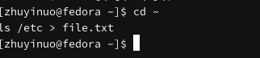
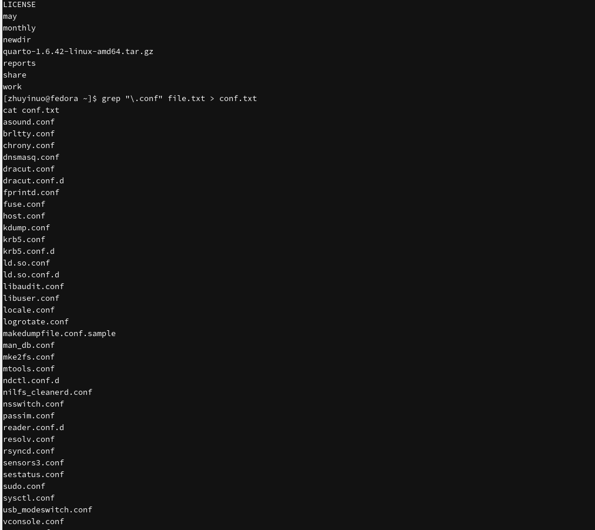
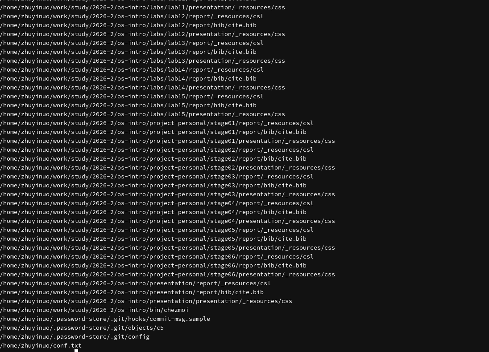
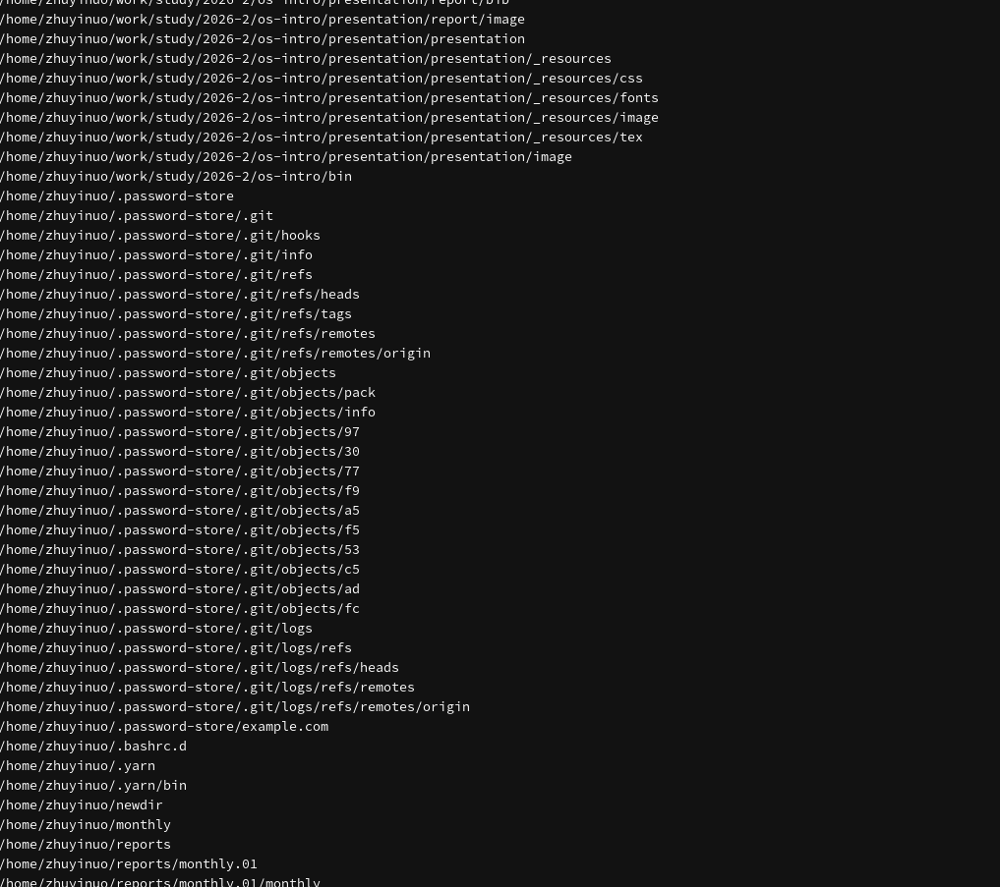
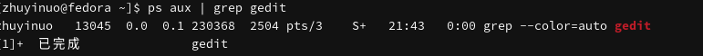
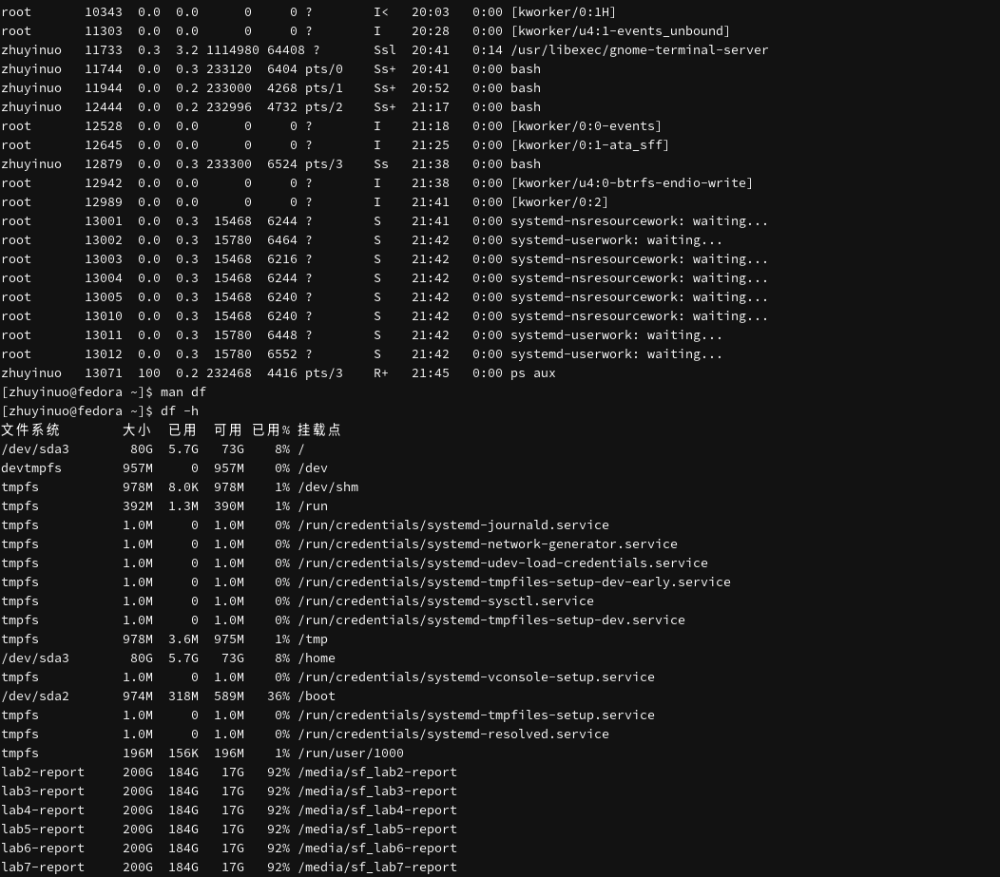
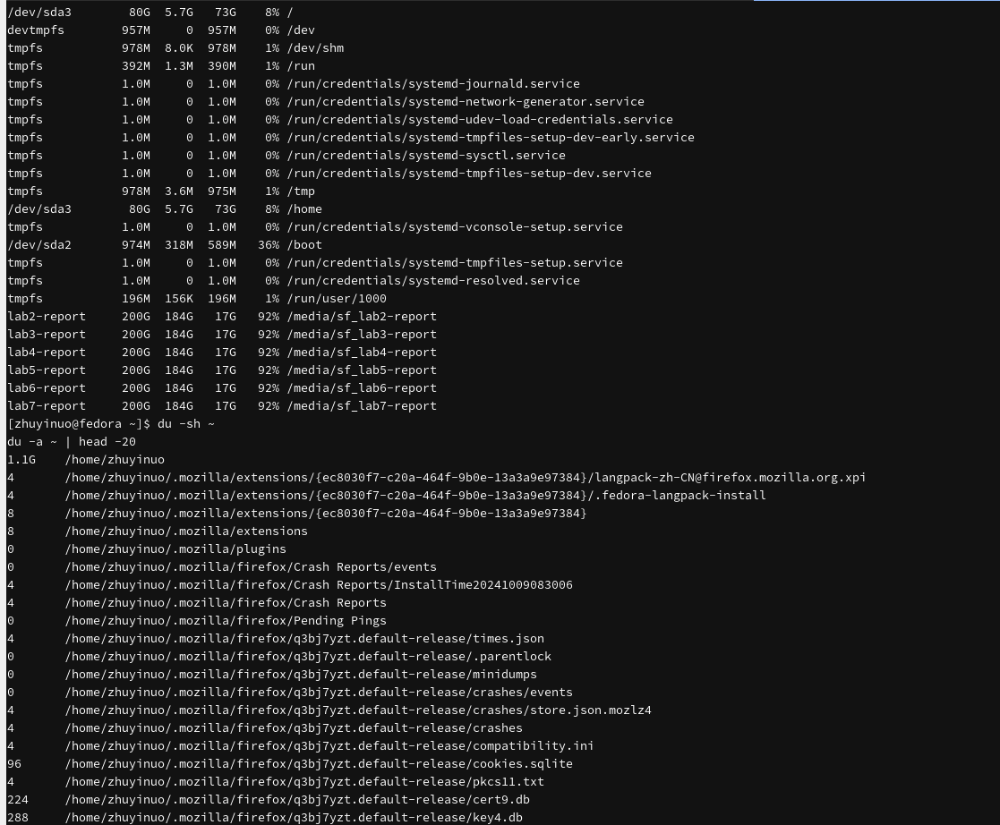

---
## Author
author:
  name: Чжу Ино
  affiliation:
    - name: Российский университет дружбы народов
      country: Российская Федерация
      postal-code: 117198
      city: Москва
      address: ул. Миклухо-Маклая, д. 6
## Title
title: Лабораторная работа № 8
subtitle:  Поиск файлов. Перенаправление ввода-вывода
date: today
date-format: "YYYY-MM-DD"
format:
  beamer:
    theme: "Madrid"
    colortheme: "default"
    lang: ru
    toc: false
    slide-level: 2
    mainfont: "DejaVu Serif"
    sansfont: "DejaVu Sans"
    monofont: "DejaVu Sans Mono"
  html:
    embed-resources: true
---

# Информация

## Докладчик

::: {.columns align=center}
::: {.column width="50%"}
- Чжу Ино
- группа НПИбд-03-25
- Российский университет дружбы народов им. П. Лумумбы
- Студенческий билет: 1132258331
:::
::: {.column width="50%"}
:::
:::

# Вводная часть

## Цель работы

- Ознакомление с инструментами поиска файлов
- Приобретение навыков управления процессами

## Задачи

- Освоить перенаправление
- Изучить конвейер
- Освоить `find`, `grep`
- Управление задачами и процессами
- Проверка диска

# Теоретические сведения

## Перенаправление

- `>` — перезапись
- `>>` — добавление
- `2>` — stderr
- `&>` — stdout + stderr

## Конвейер

```bash
команда1 | команда2
```

## Поиск

```bash
find ~ -name "f*" -print
```

## Фильтрация

```bash
grep строка имя_файла
```

## Диск

- `df` — разделы
- `du` — объёмы

## Задачи и процессы

- `jobs` — задачи
- `ps aux` — процессы
- `kill` — завершение

# Выполнение лабораторной работы

## Перенаправление

```bash
ls /etc > file.txt
ls ~ >> file.txt
```



## Фильтрация

```bash
grep "\.conf" file.txt > conf.txt
```



## Поиск файлов

```bash
find ~ -name "c*" -print
find ~ -type d -print
```





## Задачи

```bash
gedit &
jobs
```


## Процессы

```bash
ps aux | grep gedit
```



## kill

```bash
kill %1
```


## Диск

```bash
df -h
du -sh ~
```





# Результаты

## Результаты работы

- Освоено перенаправление ввода-вывода
- Изучен конвейер
- Освоен поиск файлов
- Освоено управление задачами и процессами
- Проверено использование диска

# Заключение

## Главный вывод

Изучены инструменты поиска и фильтрации, перенаправление, конвейер, управление процессами и анализ диска.