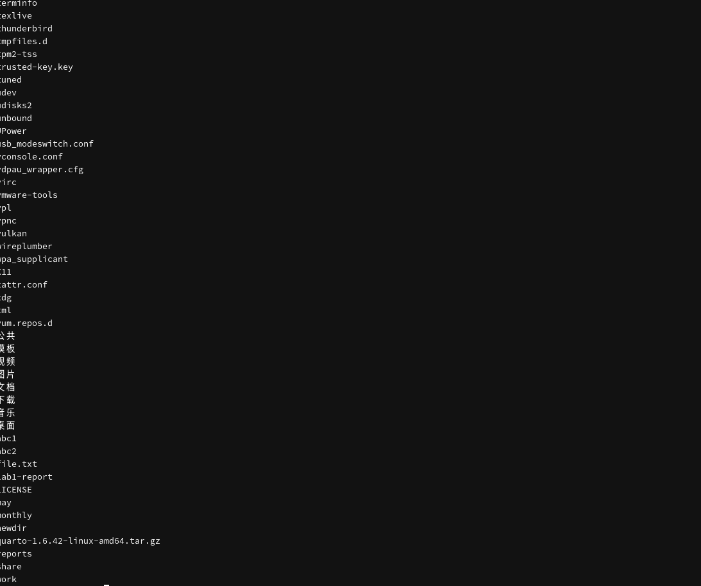
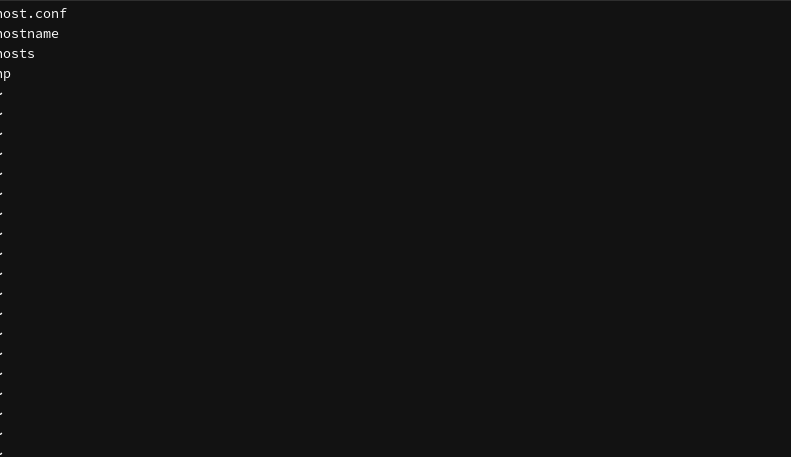
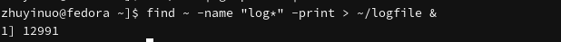
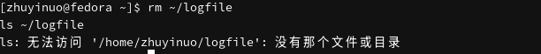
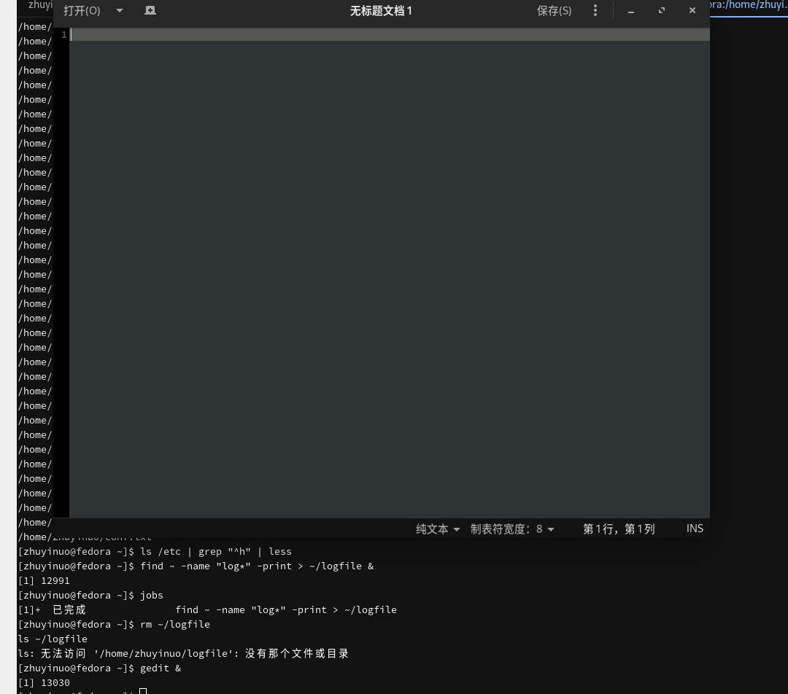
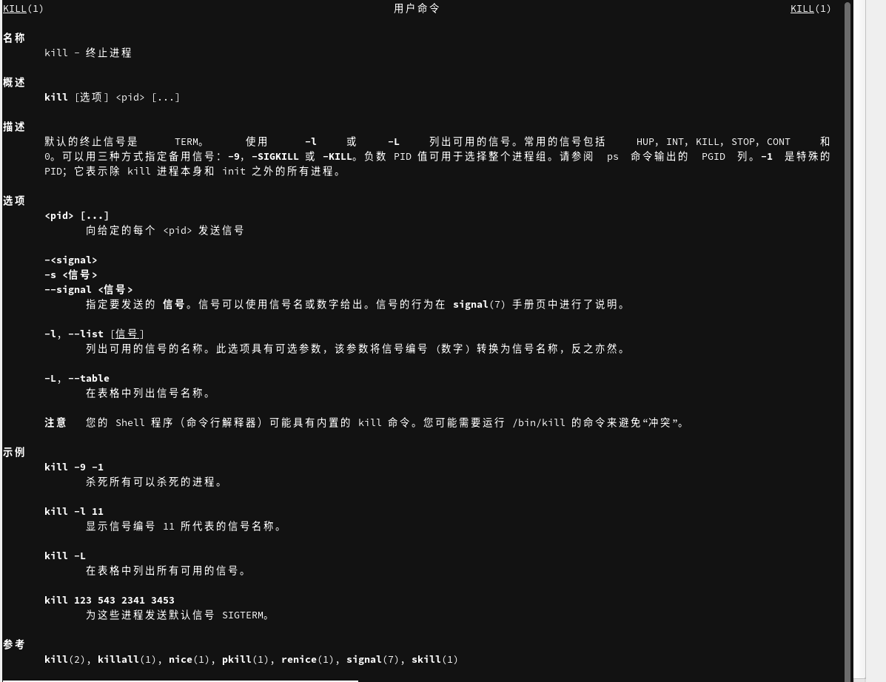
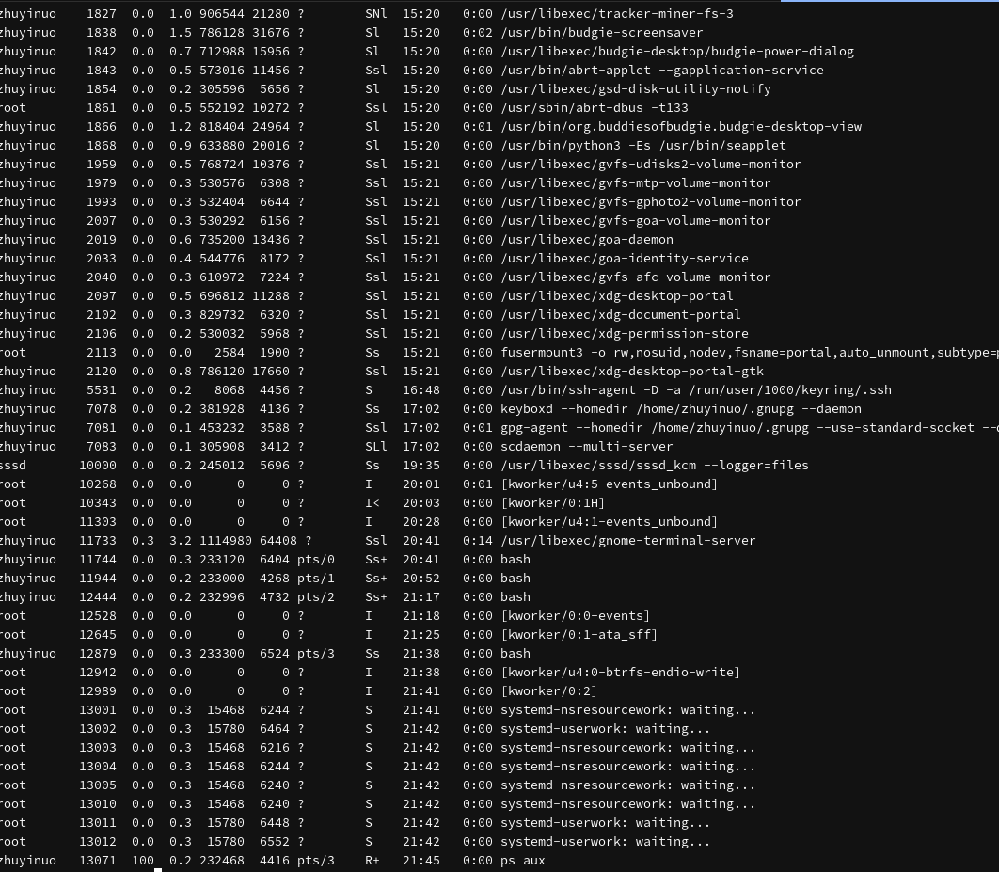
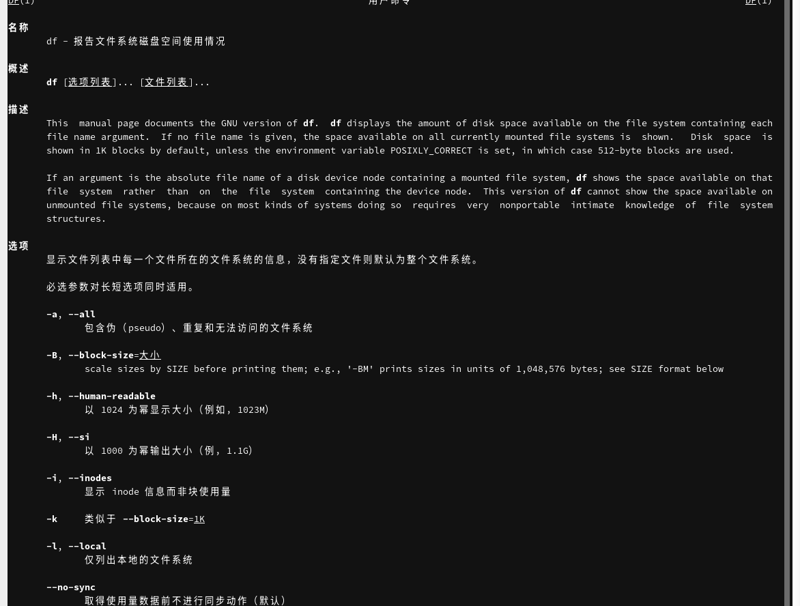
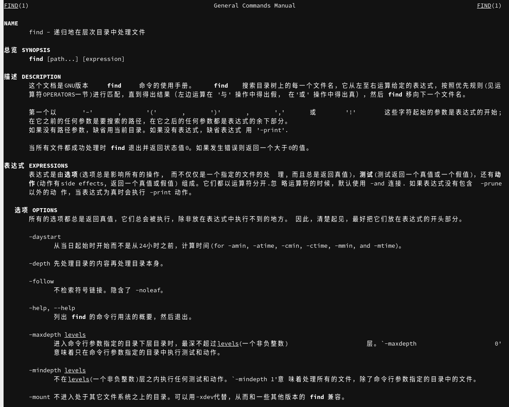

# Цель работы

Ознакомление с инструментами поиска файлов и фильтрации текстовых данных. Приобретение практических навыков по управлению процессами и заданиями, по проверке использования диска.

# Задачи

1. Освоить перенаправление ввода-вывода.
2. Изучить конвейер.
3. Освоить поиск файлов с помощью `find`.
4. Изучить фильтрацию текста с помощью `grep`.
5. Освоить управление задачами и процессами.
6. Проверить использование диска.

# Теоретические сведения

## Перенаправление ввода-вывода

- `stdin` — стандартный поток ввода (дескриптор 0)
- `stdout` — стандартный поток вывода (дескриптор 1)
- `stderr` — поток ошибок (дескриптор 2)

Операторы:

- `>` — перезапись файла
- `>>` — добавление в файл
- `2>` — перенаправление stderr
- `&>` — stdout и stderr в файл

## Конвейер

```bash
команда1 | команда2
```

Вывод команды 1 передаётся на вход команде 2.

## Поиск файлов

```bash
find путь [-опции]
```

Пример:

```bash
find ~ -name "f*" -print
```

## Фильтрация текста

```bash
grep строка имя_файла
```

## Проверка использования диска

- `df` — размер смонтированных разделов
- `du` — объём файлов и каталогов

## Управление задачами

- `команда &` — запуск в фоне
- `jobs` — список задач
- `kill %номер` — завершение задачи

## Управление процессами

- `ps aux` — информация о процессах
- `kill PID` — завершение процесса

# Выполнение лабораторной работы

## Перенаправление вывода

Записаны имена файлов каталога `/etc` в файл `file.txt`:

```bash
cd ~
ls /etc > file.txt
```

{#fig-redirect width=80%}

## Добавление в файл

```bash
ls ~ >> file.txt
cat file.txt
```

{#fig-append width=80%}

## Фильтрация .conf

```bash
grep "\.conf" file.txt > conf.txt
cat conf.txt
```

{#fig-grep-conf width=80%}

## Поиск файлов на c

```bash
find ~ -name "c*" -print
```

{#fig-find-c width=80%}

## Файлы /etc на h

```bash
ls /etc | grep "^h" | less
```

{#fig-etc-h width=80%}

## Поиск в фоне

```bash
find ~ -name "log*" -print > ~/logfile &
```

{#fig-find-bg width=80%}

## Просмотр задач

```bash
jobs
```

{#fig-jobs width=80%}

## Удаление logfile

```bash
rm ~/logfile
ls ~/logfile
```

{#fig-rm-logfile width=80%}

## Запуск gedit в фоне

```bash
gedit &
```

{#fig-gedit-bg width=80%}

## Поиск процесса gedit

```bash
ps aux | grep gedit
```

{#fig-ps-gedit width=80%}

## man kill

```bash
man kill
```

{#fig-man-kill width=80%}

## Завершение gedit

```bash
kill %1
jobs
```

{#fig-kill-gedit width=80%}

## Все процессы

```bash
ps aux
```

{#fig-ps-aux width=80%}

## man df

```bash
man df
```

{#fig-man-df width=80%}

## df -h

```bash
df -h
```

{#fig-df width=80%}

## du

```bash
du -sh ~
du -a ~ | head -20
```

{#fig-du width=80%}

## man find

```bash
man find
```

{#fig-man-find width=80%}

## Все директории

```bash
find ~ -type d -print
```

{#fig-find-dirs width=80%}

# Выводы

В ходе работы изучены инструменты поиска файлов и фильтрации данных. Освоены перенаправление ввода-вывода, конвейер, команды `find`, `grep`, `df`, `du`, управление задачами (`jobs`, `kill`) и процессами (`ps aux`).

# Контрольные вопросы

**1. Какие потоки ввода-вывода вы знаете?**

`stdin` (0), `stdout` (1), `stderr` (2).

**2. Разница между `>` и `>>`.**

`>` перезаписывает файл, `>>` добавляет в конец.

**3. Что такое конвейер?**

Оператор `|`, передающий вывод одной команды на вход другой.

**4. Что такое процесс?**

Выполняющаяся программа. Отличается от программы тем, что программа — это файл, а процесс — это выполняющийся экземпляр.

**5. Что такое PID и GID?**

PID — идентификатор процесса, GID — идентификатор группы.

**6. Что такое задачи и какая команда позволяет ими управлять?**

Задачи — фоновые процессы. Управление — `jobs`.

**7. Функции утилит top и http.**

`top` — просмотр процессов в реальном времени. `http` — не утилита, вероятно, имеется в виду `htop` — улучшенный `top`.

**8. Команда поиска файлов.**

```bash
find ~ -name "*.txt" -print
```

**9. Можно ли найти файл по содержанию?**

Да, с помощью `grep`:

```bash
grep -r "текст" ~
```

**10. Как определить объём свободной памяти?**

```bash
df -h
```

**11. Как определить объём домашнего каталога?**

```bash
du -sh ~
```

**12. Как удалить зависший процесс?**

```bash
kill -9 PID
```

# Список литературы

1. Робачевский А., Немнюгин С., Стесик О. Операционная система UNIX. — БХВ-Петербург, 2010.
2. Колисниченко Д. Н. Самоучитель системного администратора Linux. — БХВ-Петербург, 2011.
3. Таненбаум Э., Бос Х. Современные операционные системы. — Питер, 2015.