# Цель работы

Освоение основных возможностей командной оболочки Midnight Commander. Приобретение навыков практической работы по просмотру каталогов и файлов, манипуляций с ними.

# Задачи

1. Изучить общие сведения о Midnight Commander.
2. Освоить режимы отображения панелей и управление ими.
3. Изучить меню панелей, меню Файл, Команда, Настройки.
4. Освоить встроенный редактор mc.

# Теоретические сведения

## Общие сведения

Midnight Commander (mc) — псевдографическая командная оболочка для UNIX/Linux. Запуск:

```bash
mc
```

Рабочее пространство mc имеет две панели. Меню доступно по клавише `F9`.

## Функциональные клавиши

- `F1` — справка
- `F3` — просмотр
- `F4` — редактирование
- `F5` — копирование
- `F6` — перемещение/переименование
- `F7` — создание каталога
- `F8` — удаление
- `F9` — меню
- `F10` — выход

## Режимы отображения панелей

- `Ctrl+U` — поменять панели местами
- `Ctrl+O` — отключить панели
- `Ctrl+X D` — сравнить каталоги

Режимы: **Информация**, **Дерево**.

## Меню

- Левая панель
- Файл
- Команда
- Настройки
- Правая панель

## Меню Файл

- Просмотр (F3)
- Просмотр вывода команды (M+!)
- Правка (F4)
- Копирование (F5)
- Права доступа (Ctrl+X C)
- Жёсткая ссылка (Ctrl+X L)
- Символическая ссылка (Ctrl+X S)
- Владелец/группа (Ctrl+X O)
- Переименование (F6)
- Создание каталога (F7)
- Удалить (F8)
- Выход (F10)

## Меню Команда

- Дерево каталогов
- Поиск файла
- Переставить панели
- Сравнить каталоги (Ctrl+X D)
- Размеры каталогов
- История командной строки
- Каталоги быстрого доступа (Ctrl+\)
- Восстановление файлов
- Редактировать файл расширений
- Редактировать файл меню
- Редактировать файл расцветки имён

## Меню Настройки

- Конфигурация
- Внешний вид
- Настройки панели
- Настройки кодировок
- Виртуальный терминал
- Сохранение настроек

# Выполнение лабораторной работы

## Установка mc

```bash
sudo dnf -y install mc
mc --version
```

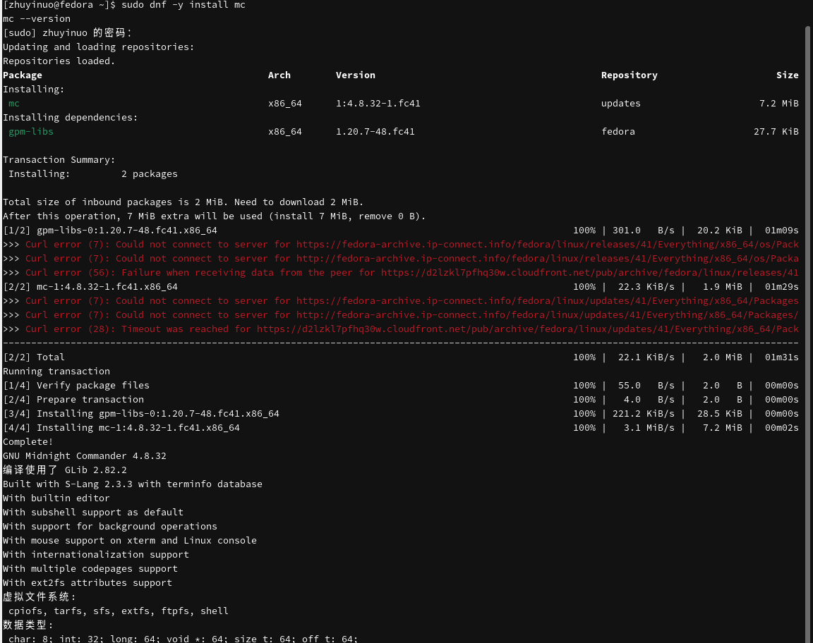{#fig-install width=80%}

## Запуск mc

```bash
mc
```

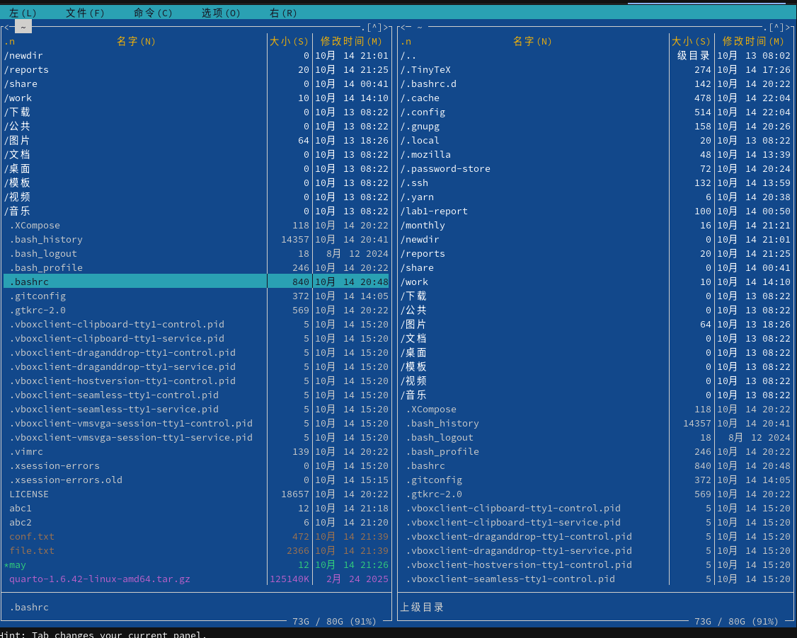{#fig-start width=80%}

## Справка mc

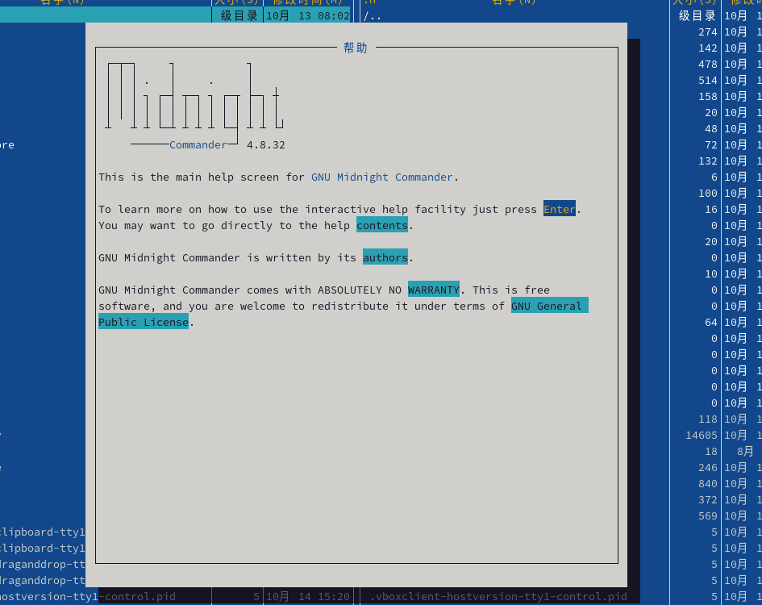{#fig-help width=80%}

## Переключение панелей

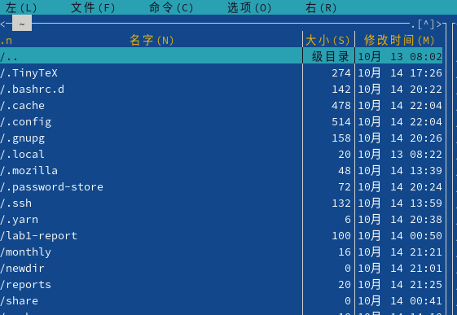{#fig-tab width=80%}

## Поменять панели местами

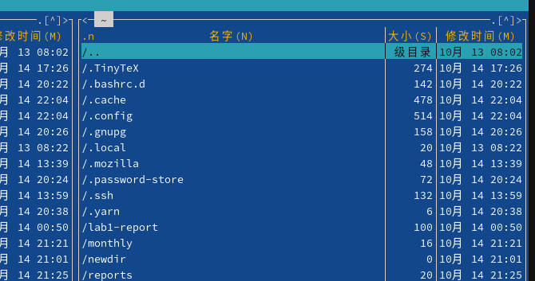{#fig-swap width=80%}

## Режим Информация

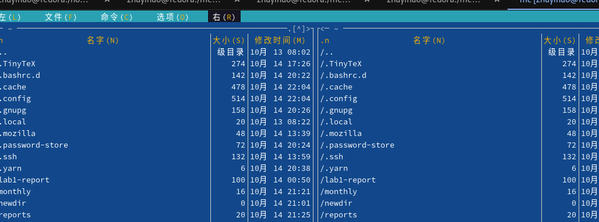{#fig-info width=80%}

## Режим Дерево

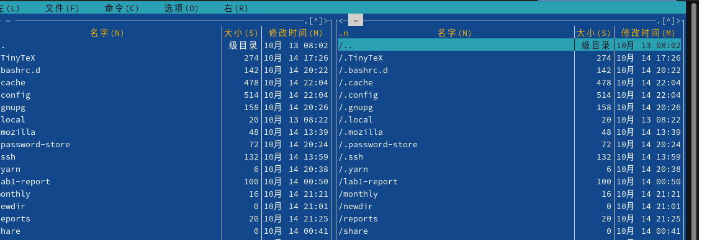{#fig-tree width=80%}

## Меню Файл

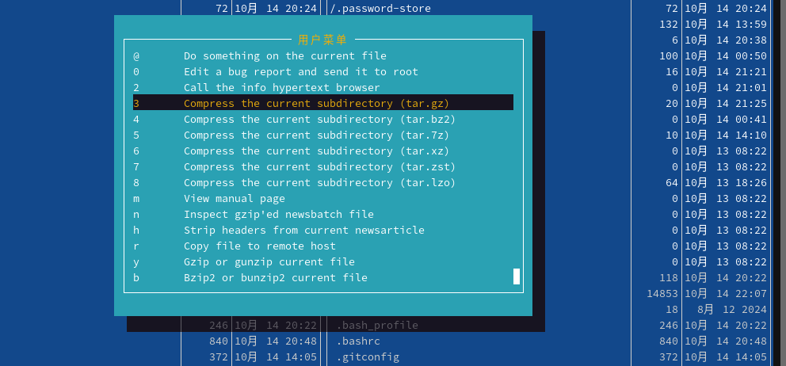{#fig-file width=80%}

## Меню Настройки

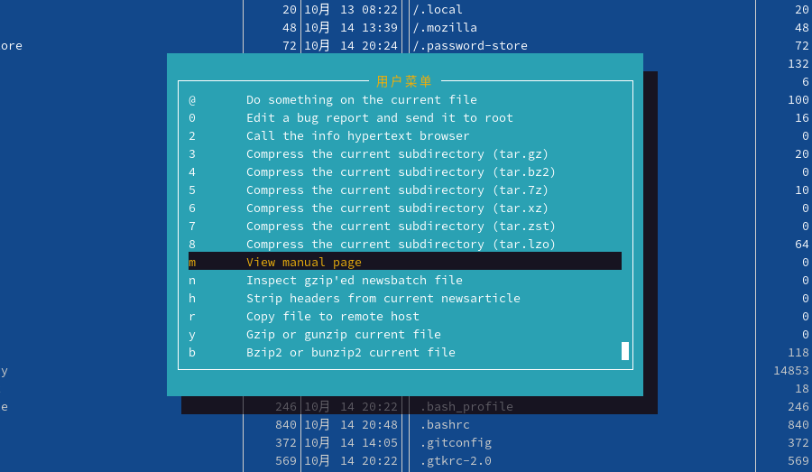{#fig-settings width=80%}

## Меню панелей

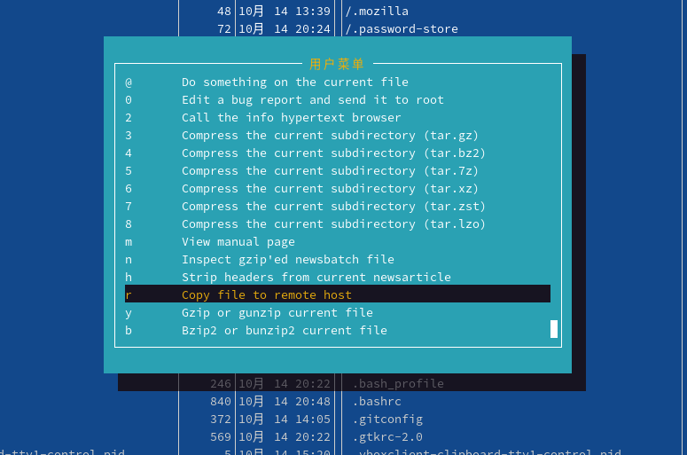{#fig-panel width=80%}

## Создание каталога

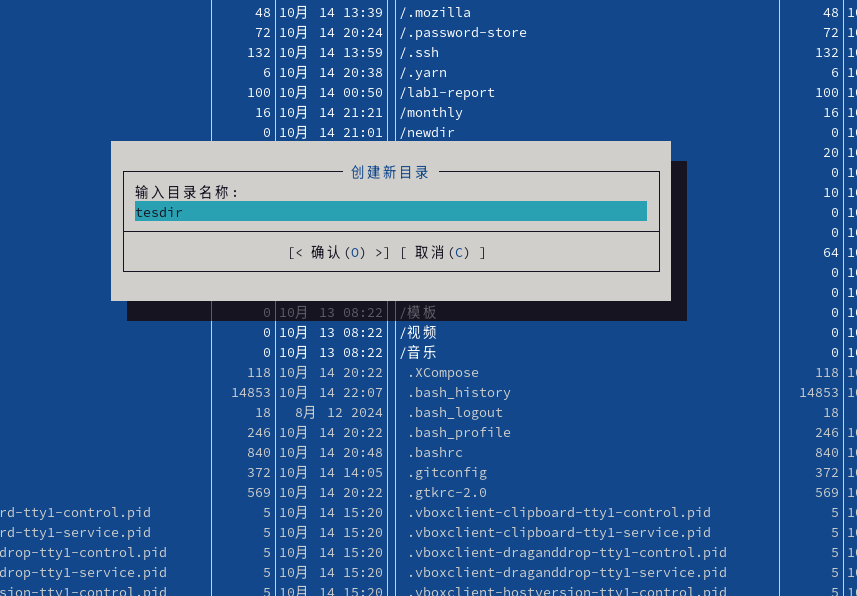{#fig-mkdir width=80%}

## Копирование файла

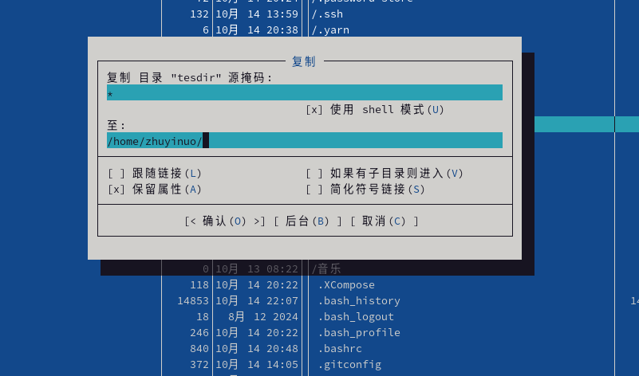{#fig-copy width=80%}

## Перемещение файла

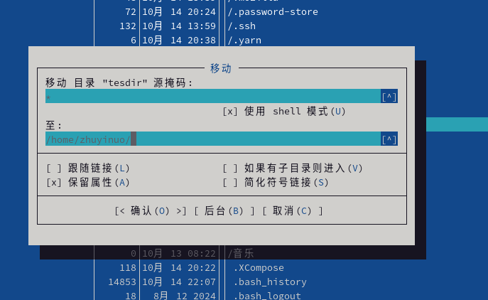{#fig-move width=80%}

## Удаление файла

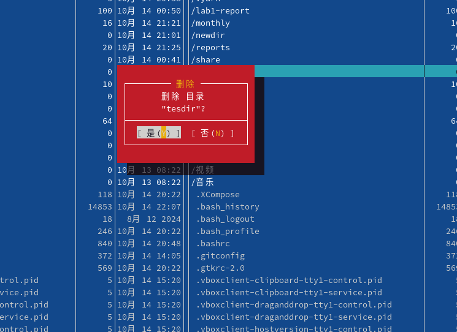{#fig-delete width=80%}

## Просмотр файла

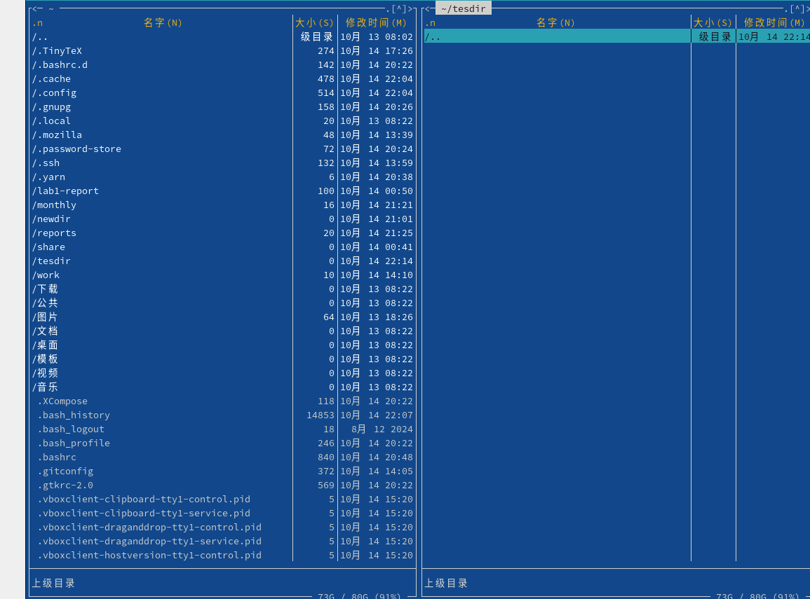{#fig-view width=80%}

## Встроенный редактор

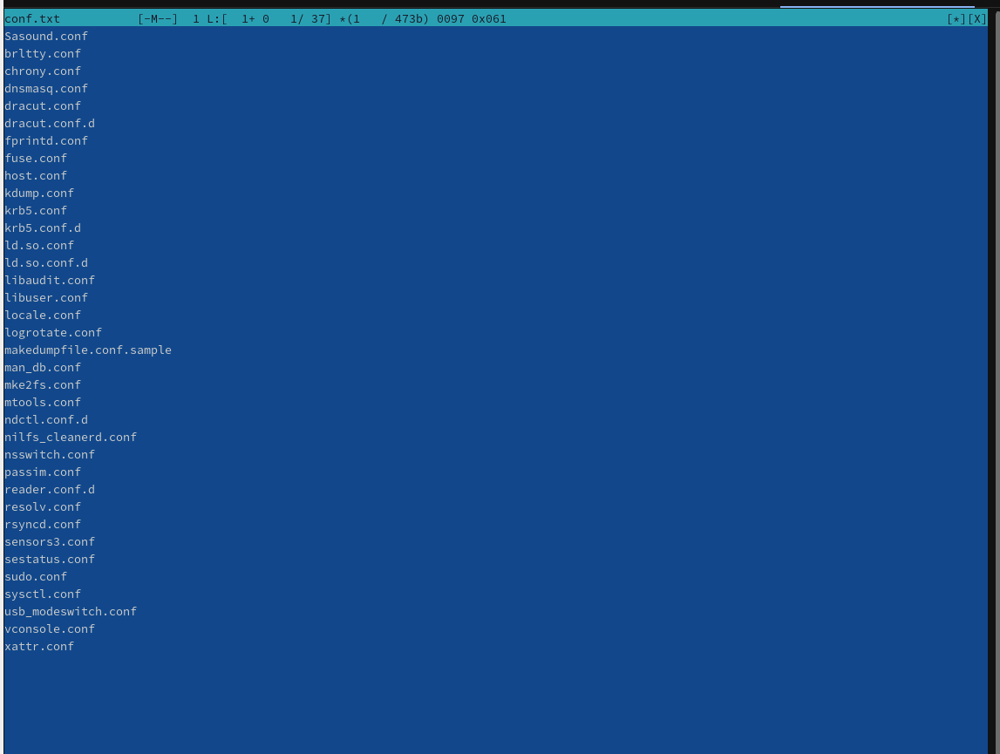{#fig-editor width=80%}

# Выводы

В ходе работы освоены основные возможности Midnight Commander: управление панелями, меню Файл, Команда, Настройки, работа с файлами и каталогами, встроенный редактор.

# Контрольные вопросы

**1. Какие режимы работы есть в mc?**

Режимы панелей: стандартный, ускоренный, расширенный, определённый пользователем, Информация, Дерево.

**2. Какие операции с файлами можно выполнить в mc?**

Просмотр (F3), редактирование (F4), копирование (F5), перемещение (F6), создание каталога (F7), удаление (F8).

**3. Структура меню левой/правой панели.**

Формат списка, Порядок сортировки, Быстрый просмотр, Информация, Дерево.

**4. Структура меню Файл.**

Просмотр, Правка, Копирование, Права доступа, Ссылки, Переименование, Создание каталога, Удаление, Выход.

**5. Структура меню Команда.**

Дерево каталогов, Поиск файла, Переставить панели, Сравнить каталоги, Размеры каталогов, История командной строки, Каталоги быстрого доступа, Восстановление файлов, Редактирование файлов настроек.

**6. Структура меню Настройки.**

Конфигурация, Внешний вид, Настройки панели, Настройки кодировок, Виртуальный терминал.

**7. Встроенные команды mc.**

`cd`, `ls`, `mkdir`, `rm`, `cp`, `mv`, `find`, `grep`.

**8. Команды встроенного редактора mc.**

`F2` — сохранить, `F3` — отметить начало, `F4` — заменить, `F5` — копировать, `F6` — переместить, `F7` — поиск, `F8` — удалить, `F9` — формат, `F10` — выход.

**9. Средства создания меню пользователя.**

`F2` — контекстное меню пользователя, файл `~/.mc.menu`.

**10. Средства определения действий пользователя над текущим файлом.**

Файл расширений `~/.mc.ext`, редактор `Редактировать файл расширений`.

# Список литературы

1. Курячий К. В. Операционная система UNIX. — М. : ИНТУИТ, 2016.
2. Робачевский А., Немнюгин С., Стесик О. Операционная система UNIX. — БХВ-Петербург, 2010.
3. Колисниченко Д. Н. Самоучитель системного администратора Linux. — БХВ-Петербург, 2011.